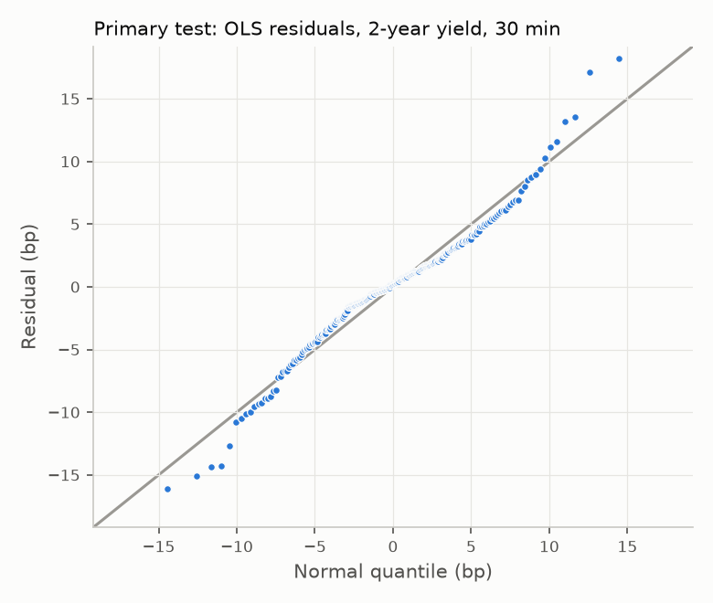

# Case study 1: FOMC communications

Study design for the first case study of `text-signals`: the goal, the data, the full method and
the decisions taken so far. It is a working document. When a decision changes, change it here and
record why in the [decision log](#12-decision-log). Items marked **proposed** are not decided yet.

Anything generic (document model, fetch cache, point-in-time join, extraction cache, evaluation
metrics, event study) goes into the shared library, so that later case studies (SEC filings,
earnings calls, other central banks) can reuse it.

---

## 1. Goal

### 1.1 The question

When the Federal Reserve publishes a monetary policy statement, the rate decision itself is
usually expected: markets have priced it in the days before. What moves the bond market on the
day is mostly what the text implies about the **future path** of policy. Gürkaynak, Sack and
Swanson (2005) show that a "path" factor, distinct from the surprise in the rate decision,
accounts for most of the response of longer yields to FOMC announcements.

The study asks:

> Can a local LLM, reading only the text of an FOMC communication, measure its policy stance well
> enough to explain the bond market's reaction on the release day, beyond the rate decision and
> beyond classic text baselines? And how much of that result survives once look-ahead bias is
> removed?

Example from the corpus: on 13 December 2023 the FOMC left rates unchanged, as expected, but the
statement now spoke of "the extent of **any** additional policy firming". Markets read the end of
the hiking cycle, and the 2-year yield fell 27 bp that day. (The projections and the press
conference released the same afternoon contributed too; see §4.3.)

### 1.2 What the study is not

- **Not a speed race.** The number in a statement is parsed by machines within milliseconds of
  release. A local LLM taking seconds per document cannot compete on that, and does not try to.
- **Not a trading strategy as such.** H1–H3 measure how much of the same-day reaction the text
  explains. That is an explanatory result. A predictive question, without a speed race, is the
  proposed H4.

### 1.3 Why it matters for investment research

1. **Measurement.** A structured, auditable reading of central bank communication (stance on
   inflation, labour, growth, forward guidance, wording changes with verbatim evidence) that can
   feed rates research, risk attribution and medium-frequency models.
2. **Analyst productivity.** Most of the value is in long documents that nobody reads in five
   minutes: minutes, speeches, and later 10-K filings and earnings calls. The same pipeline
   applies to them.
3. **Look-ahead bias.** An LLM trained on data after a document's date has read how history
   unfolded. Showing how much of a backtest survives after the model's training cutoff, or on
   anonymised documents, matters more than a high R².

---

## 2. Hypotheses

- **H1 (signal).** On FOMC statement days, an LLM tone score explains the change in the 2-year
  Treasury yield in the 30-minute statement window (USMPD `UST2Y`, §3.4), with a coefficient
  significantly different from zero after controlling for the policy surprise (MP1) and for the
  Loughran–McDonald (LM) and FinBERT scores. *Until 2026-11-05 the outcome was the daily ΔDGS2,
  which is now a robustness check (§12).*
- **H2 (incremental content).** The LLM score keeps explanatory power on the *change* in wording
  versus the previous statement, not only on its level.
- **H3 (look-ahead).** The H1 effect is weaker (i) on meetings after the model's training cutoff
  and (ii) on anonymised documents. The size of the gap is a result in itself, whichever way it
  goes.
- **H4 (drift), proposed.** The LLM tone score predicts the change in DGS2 over the following
  days (from the event day to event day + 5 trading days), i.e. the market takes time to absorb
  the nuances of the text. This is a genuinely out-of-sample predictive test. It must be accepted
  or dropped before any H4 number is computed.

Negative results get reported. A null H1 with a clean protocol is a valid deliverable.

---

## 3. Data

### 3.1 Inventory

| Data | Source | Coverage | Status |
|---|---|---|---|
| FOMC meeting calendar | federalreserve.gov: `fomccalendars.htm`, `fomchistoricalYYYY.htm` | 1994 → 2027 (318 meetings and calls) | fetched |
| FOMC statements | federalreserve.gov press releases (4 URL layouts, 1994 → today) | 250 statements, 1994-02-04 → 2026-10-28 | fetched, parsed |
| FOMC minutes | federalreserve.gov (`/fomc/MINUTES/…`, `/fomc/minutes/…`, `/monetarypolicy/fomcminutes…`, `/monetarypolicy/fomcYYYYMMDD.htm`) | 262 minutes, released 1994-03-25 → 2026-10-07; median 7,016 words | fetched, parsed, release dates checked (§3.5) |
| Press conference transcripts | federalreserve.gov (`/mediacenter/files/FOMCpresconfYYYYMMDD.pdf`) | 96 transcripts, 2011-04-27 → 2026-10-28; median 8,663 words | fetched, parsed, dates checked (§3.5) |
| 2-year Treasury yield, DGS2 | FRED `fredgraph.csv` (no key) | 1976 → today, daily | fetched |
| 10-year Treasury yield, DGS10 | FRED `fredgraph.csv` | 1962 → today, daily | fetched |
| 3-month Treasury yield, DGS3MO | FRED `fredgraph.csv` | 1981 → today, daily | fetched (robustness control, §6.2) |
| Upper bound of the fed funds target range, DFEDTARU | FRED `fredgraph.csv` | 2008-12-16 → today, daily | fetched (zero-lower-bound flag, §6.3) |
| Intraday rate changes and policy surprises (USMPD) | San Francisco Fed, `sffed.us/usmpd` | 280 statements 1994 → 2026-10-28, press conferences from 2011, minutes from 2001 | fetched, parsed, joined to the event table (§3.4) |
| Loughran–McDonald dictionary | Notre Dame SRAF, master dictionary 1993-2025 (Google Drive) | 86,553 words | fetched, sha256 pinned |
| FinBERT (`ProsusAI/finbert`) | Hugging Face, revision `0bc2ac10`, weights sha256 pinned | 250 statements, 3,475 sentences | scored, joined to the event table (§5.2) |
| FOMC hawkish/dovish classifier (`gtfintechlab/FOMC-RoBERTa`) | Hugging Face, gated (access granted by the authors on request) | – | access to request; contamination checked (§5.2) |
| Local LLMs | open-weight models served by `llama-server` | – | to choose (week 2) |
| Hand-labelled statements | written by us | ~60 statements | to do (week 2) |

Everything is fetched by code (`just fetch-fomc`) and nothing in `data/` is committed. The
hand-labelled sets are the exception: they cannot be regenerated, so they will be versioned under
`labels/`.

### 3.2 Formats

| Layer | Path | Format |
|---|---|---|
| Raw | `data/raw/<host>/<path>` | files exactly as fetched (HTML, CSV, PDF) |
| Provenance | `data/raw/manifest.jsonl` | one JSON line per file: `url`, `final_url`, `fetched_at`, `status_code`, `content_type`, `sha256`, `path`, `note` |
| Documents | `data/interim/fomc/statements.jsonl`, `minutes.jsonl`, `press_conferences.jsonl` | one `Document` per line (below) |
| Event table | `data/processed/fomc/statement_events.csv` | one row per statement: release, event and pre-event days, daily yield levels, ΔDGS2 / ΔDGS10 / Δ2s10s / ΔDGS3MO in bp, USMPD 30-minute changes (2y, 10y, 2s10s), MP1 (published and recomputed), MP2 and USMPD version, main-sample flags, zero-lower-bound flag `zlb`, LM scores, FinBERT scores (`finbert_*`) |
| Model weights | `data/raw/huggingface/` | Hugging Face cache at the pinned revision |
| Encoder scores | `data/interim/fomc/encoder_scores/<encoder>.jsonl` | one `EncoderScore` per document: model, revision, weights sha256, splitter version, sentences and their class probabilities |

`Document` fields: `doc_id`, `corpus`, `doc_type`, `event_date` (last day of the meeting),
`release_date` (the point-in-time key), `release_time_et` (when the page states it),
`release_time_source` (`document` or `none`), `unscheduled`, `url`, `raw_sha256` (links to the
manifest), `title`, `text` (paragraphs separated by a blank line), `source_status` (the status the
source gives a document it revises after release: `preliminary` or `final` for transcripts).

### 3.3 Provenance rules

- Raw files are stored as fetched, with URL, fetch time and sha256. A cached file that no longer
  matches its sha256 is an error.
- Files whose content is pinned (the LM dictionary) are checked against the pinned sha256
  *before* being cached. Google Drive answers HTTP 200 with a "quota exceeded" page at times; a
  copy downloaded by hand can be imported (`just import-lm <file>`) only if it matches the pin,
  and the manifest says so in `note`.
- Polite fetching: a 2-second delay between requests and a descriptive User-Agent without a
  personal address.

### 3.4 Intraday data: the San Francisco Fed event-study database (found 2026-11-05)

The **U.S. Monetary Policy Event-Study Database** (USMPD) is published by the San Francisco Fed's
Center for Monetary Research (Acosta, Ajello, Bauer, Loria and Miranda-Agrippino, 2025). It is
free and needs no key. Its intraday prices come from LSEG Tick History, which we could not buy.
Its findings, and our own checks of it, go into the report.

**Files inspected on 2026-11-05** (version "Last update: 30 October 2026"). `USMPD.xlsx` is
fetched by the pipeline (`text_signals.sources.fomc.usmpd`) into `data/raw/` with a manifest line;
the fetched copy has the sha256 below. The ZIP was only inspected by hand:

| File | URL | sha256 |
|---|---|---|
| `USMPD.xlsx` | `https://www.frbsf.org/wp-content/uploads/USMPD.xlsx` | `2b91297c42cf692dd74f65eabf7ee97f81d452676e23fa02edb222bfa60f0d0a` |
| `monetary-policy-surprises.zip` (R code, `mps.csv`, `mps_minutes.csv`) | `https://www.frbsf.org/wp-content/uploads/monetary-policy-surprises.zip` | `ee9f98bc6a2b49e43078dde0028413c6ca008df39fa57104ca1bf1174c27af0d` |

The page states no licence. It asks to cite the working paper (§11).

**Content.** There is one row per event, with the event's timestamp in Eastern Time. The database
gives the *change* of each price over the window, not the tick series.

| Sheet | Events | Window |
|---|---|---|
| Statements | 280, 1994-02-04 → 2026-10-28 | 10 min before → 20 min after the release |
| Press Conferences | 96, from 2011-04-27 | 10 min before → 60 min after its start |
| Monetary Events | 280 | statement and press conference together (100 min) |
| Minutes | 207, from 2001-02-01 | 10 min before → 20 min after the release |

The variables are the following. Rates are in percentage points and returns in percent.

- MP1 and MP2: fed funds futures surprises (below).
- FF1–FF6: fed funds futures.
- ED1–ED8: Eurodollar futures, then SOFR futures from 2022.
- OIS 1y and 2y.
- Treasury yields 3m, 6m, 2y, 5y, 10y and 30y, and TIPS 5y, 10y and 30y.
- S&P 500 and the E-mini future, DXY, EURUSD and USDJPY.
- Indicator flags: `SEP`, `Unscheduled` and `PC`.

**Policy surprises.**

- **MP1** is the surprise in the current decision (Kuttner, 2001). Write D for the number of days
  in the month and d for the day of the meeting. Then MP1 = FF1 × D / (D − d), or MP1 = FF2 when
  the meeting falls in the last 7 days of the month. We recomputed it from FF1 and FF2 and
  matched the database on **280 of 280** statements.
- **MP2** is the surprise in the expected rate after the next meeting (Gürkaynak, Sack and
  Swanson, 2005).
- **The PCA surprise** (`mps.csv`, from the authors' `mps.R`) is the first principal component
  of MP1, MP2 and ED2–ED4. These cover about one year ahead (Nakamura and Steinsson, 2018). It is
  scaled by a regression of the daily change in the one-year zero-coupon yield on it, so that it
  moves that yield one for one.
  - *Caveat for our question:* this surprise spans about a year, so it **includes the
    guidance**. Used as a control, it would absorb the effect the text is meant to carry. MP1
    only removes the surprise in the decision itself.
  - *Look-ahead:* the principal component and its scaling are estimated on the full sample. They
    are fine in-sample but not for the out-of-sample test (§6.4); `mps.R` has an `END_DATE`
    option for this.

**Where each concept comes from.** The report cites the paper that introduced each concept, not
only the database that computes it.

| Concept | Origin | What we take from it |
|---|---|---|
| Policy surprise from fed funds futures (MP1), scaled by D / (D − d) | Kuttner (2001) | the surprise in the current decision |
| Next-meeting surprise (MP2); target and path factors (`gss.R`) | Gürkaynak, Sack and Swanson (2005) | the surprise about the next meeting; the split between the decision and the guidance |
| The last-7-days rule (use FF2) | used in Gürkaynak, Sack and Swanson (2005), to confirm in the paper | it matches USMPD on 280 of 280 statements |
| Surprise as the first principal component of futures changes over about one year | Nakamura and Steinsson (2018) | the "policy news" surprise |
| The USMPD variant: inputs MP1, MP2 and ED2–ED4, scaled on the one-year yield; the windows and the database | Acosta et al. (2025) | the intraday changes and the surprises we use |
| One-year zero-coupon yield used for the scaling (`SVENY01`) | Gürkaynak, Sack and Wright (2007) | the yield curve behind `y1.csv` |

**Checks against our event table (§3.2).**

- **Overlap.** 248 of our 250 statements match by date.
  - The 32 USMPD events we lack are, apart from two, the 1994–1999 meetings that left rates
    unchanged. No statement was issued then, so there is no text to score.
  - The other two are the unscheduled actions of 4 October 2019 and 19 March 2020.
- **Mismatch 1: October 2019. Resolved 2026-11-05: the USMPD row is misdated.**
  - USMPD dates an event on 4 October 2019 at 11:00 ET, the day of the conference call.
  - The Fed's press release index (`federalreserve.gov/json/ne-press.json`, read 2026-11-05)
    lists no monetary policy release on 4 October 2019. The "Statement Regarding Monetary Policy
    Implementation" came out on **11 October 2019 at 11:00 AM**, the time USMPD gives. Powell's
    only remarks on 4 October were at 2:00 PM (`ne-speeches.json`).
  - For every other unscheduled event, USMPD uses the release date (e.g. 22 January 2008 for
    the call of the 21st), as we do. The row looks like the call date combined with the release
    time.
  - Which day its numbers measure cannot be known without the ticks, so the row is used for
    nothing.
  - The announcement had also been previewed: on 8 October 2019 at 2:30 PM, Powell said "my
    colleagues and I will soon announce measures to add to the supply of reserves over time"
    (`/newsevents/speech/powell20191008a.htm`). The statement itself calls the measures "purely
    technical" and "not a change in the stance of monetary policy".
- **Mismatch 2: 22 August 2025. Resolved 2026-11-05: confounded with a speech by the Chair.**
  - The revised Statement on Longer-Run Goals was released at **10:00 AM**, the minute Powell's
    Jackson Hole speech began ("Monetary Policy and the Fed's Framework Review",
    `powell20250822a.htm`). Any window, daily or intraday, mixes the two, and the speech carried
    the policy news. Our daily ΔDGS2 that day is −11 bp.
  - The 2020 revision has the same structure: statement and Powell speech both at 9:10 AM on
    27 August 2020. USMPD **includes** 2020-08-27 but not 2025-08-22, so its coverage of these
    events is not consistent and cannot settle the question for us.
- **Corpus gap to check.** USMPD's unscheduled event of 19 March 2020 at 9:00 is the dollar
  swap lines with nine central banks (`monetary20200319b.htm`). It is not in our statement
  corpus, which follows the FOMC calendar links.
- **Daily against intraday.** On the 248 common statements, our daily changes and the 30-minute
  changes are correlated at **0.61 (2y)** and **0.64 (10y)**. The standard deviation of the
  2-year change is 7.8 bp daily and 5.7 bp intraday. Example: on 18 March 2026 the 2-year yield
  rose 8 bp over the day and fell 0.9 bp in the statement window.
- **Release times.** USMPD records times of day that our pages do not give before 2016 (§4.1):
  14:15 on 125 statements, 14:00 on 109. They can be used as a cross-check, cited as USMPD, not
  as our own data.

**What was looked at.** We compared yield changes between windows and recomputed MP1. LM scores
were printed next to yield changes and surprises for six 2026 statements, to read the table. No
relation between a score and a market move was computed. The window and control decisions below
are therefore still made before seeing results.

**Decisions (fixed 2026-11-05, §7).**

1. **The main event window is the USMPD 30-minute statement window** (10 minutes before to 20
   minutes after the release). The daily window of §4.2 becomes a robustness check.
2. **The policy surprise control is MP1 from USMPD** (§6.2). ΔDGS3MO becomes a robustness
   control.

3. **Main sample (fixed 2026-11-05).** A statement is in the main sample when it has a USMPD
   30-minute change and was not released together with a speech by the Chair. This rule leaves
   out three statements, which stay in the table and enter the daily robustness check:
   - **11 October 2019**, because the USMPD row for it is misdated;
   - **27 August 2020** and **22 August 2025**, the framework statements released together with
     Powell's Jackson Hole speeches.

   That leaves 247 of 250 statements. The columns are `confounded_chair_speech` and
   `in_main_sample` in the event table.

   **Why the rule removes only these two statements (checked 2026-11-05).**
   - **Chair speeches.** We compared each USMPD statement time with every Chair speech that has
     a time in the Fed's speech index (`ne-speeches.json`; times from December 2008). Over 151
     statements, the only speech within two hours of a statement is 27 August 2020, at 0
     minutes. We checked 22 August 2025, which is not in USMPD, against our own release time:
     also 0 minutes.
   - **What this check cannot cover.** There are no speech times before December 2008, and the
     index holds speeches only, not press conferences, testimony or interviews.
   - **Press conferences** are not a confound for the main window, because it closes before the
     conference starts. From the USMPD timestamps:

     | Period | Statement → press conference | End of the +20 min window |
     |---|---|---|
     | 2011–2012 | 12:30 → 14:15, 105 min | 85 min before |
     | 2013 → 2026 | 14:00 → 14:30, 30 min | 10 min before |
     | 3 and 15 March 2020 (unscheduled) | 60 and 90 min | 40 and 70 min before |

### 3.5 Minutes and press conference transcripts (fetched 2026-11-05)

Fetched for the second stage of the study (minutes and press conferences as events of their own,
§4.1 and §5.1). Nothing below has been joined to market data or scored yet.

**Minutes.** 262 HTML pages, one per meeting with minutes, released 1994-03-25 → 2026-10-07.
Median 7,016 words (3,253 to 14,374), about 20 times a statement. Released a median 21 days after
the meeting from 2005 (175 minutes), 50 days before.

- *Four URL layouts.* The calendar parser first missed the minutes of June 2008, whose link is
  `/monetarypolicy/fomc20080625.htm` (no "minutes" in the URL). The minutes link is now the HTML
  link of the calendar paragraph that starts with "Minutes".
- *Text.* Split at block elements (paragraphs, lists, block quotes, table rows, line breaks),
  not only at `<p>`: legacy pages put the policy directive in a `<blockquote>` inside a layout
  table, the votes directly in table cells, the standing authorizations in lists. Legacy pages
  also repeat "Return to top" between sections; the body ends at the last one. Checked on all
  262 pages: the parsed text holds at least 98% of the words of the page's main container (the
  rest is the title bar and the navigation). A first `<p>`-only parser kept 12% of the September
  1996 minutes and 70–89% of 22 others.
- *Release dates.* The minutes pages do not state them; the calendar does ("Released Jul 16,
  2008"). Each of the 262 dates was checked against: the "Last update" stamp of the page (equal
  to the calendar for 233 pages; the others were edited later), the Fed's press release index
  (`federalreserve.gov/json/ne-press.json`, from 2006: 167 checked), and the USMPD minutes sheet
  (from 2001: 207). Where they disagree, Internet Archive captures of the Fed's FOMC page
  (`web.archive.org`, captures of `federalreserve.gov/fomc/`, in which a minutes link not yet
  live is commented out) settle it:

  | Minutes of | Calendar | USMPD | Other evidence | Release date used |
  |---|---|---|---|---|
  | 6 Nov 2001 | 13 Dec 2001 | 31 Dec 2001 | page stamp "December 13, 2001, 2:00 PM"; first archive capture of the page 13 Dec 2001, 23:00 UTC | **13 Dec 2001** (USMPD wrong) |
  | 28 Oct 2003 | 11 Dec 2003 | 10 Dec 2003 | page stamp "December 10, 2003, 2:00 PM"; no archive capture on 10–11 Dec | **10 Dec 2003** (calendar wrong, probable) |
  | 21 Sep 2004 | 11 Nov 2004 | 11 Nov 2004 | 11 Nov 2004 was a federal holiday, DGS2 has no value; page stamp "November 12, 2004, 2:00 PM"; the FOMC page has no live link at 8:58 p.m. ET on 11 Nov and one at 7:58 p.m. ET on 12 Nov | **12 Nov 2004** (calendar and USMPD wrong) |
  | 10 Nov 2004 | 16 Dec 2004 | 16 Dec 2004 | page stamp 17 Dec; FOMC page: no live link at 4:20 a.m. ET on 15 Dec, live at 9:40 p.m. ET on 16 Dec | **16 Dec 2004** (the stamp is a later edit) |
  | 9–10 Dec 2025 | 30 Dec 2025 | 31 Dec 2025 | press release index: 30 Dec 2025, 2:00 p.m. | **30 Dec 2025** (USMPD wrong) |
  | 15–16 Sep 2026 | 7 Oct 2026 | 8 Oct 2026 | press release index: 7 Oct 2026, 2:00 p.m.; the press conference page says "Released October 07, 2026 at 2:00 p.m." | **7 Oct 2026** (USMPD wrong) |

  The two calendar corrections are coded with their evidence
  (`minutes.RELEASE_DATE_CORRECTIONS`). The four USMPD minutes dates that are one day late (or,
  in 2001, 18 days) are to be left out of a minutes event study based on USMPD.
- *Release times.* USMPD gives 2:00 p.m. for 204 minutes and 1:00 p.m. for three. The Fed's
  press releases say "For release at 2:00 p.m. EST" for two of these (20 November 2007,
  20 February 2008) and "12:00 a.m. EST" for the third (2 January 2008). For the first two the
  USMPD window (12:50–13:20) closes before the release. To be resolved before any minutes event
  study; it does not touch the statements.
- *Pages are edited after release.* The September 2026 minutes carry the note "An error in this
  attendee's job title was corrected on November 3, 2026". The stored file and its sha256 are
  the version read.

**Press conference transcripts.** 96 PDF transcripts, 2011-04-27 → 2026-10-28, the same 96 dates
as the USMPD press conference sheet. Median 8,663 words (2,367 to 11,594). Text extracted with
`pypdf`; running headers and page numbers removed; one paragraph per speaker turn ("CHAIRMAN
POWELL.", "MICHELLE SMITH."), speaker names kept as published (including typos such as
"CHAIRMAN BERNAKE").

- *URL.* Recent meeting pages no longer link the PDF; it is served at
  `/mediacenter/files/FOMCpresconfYYYYMMDD.pdf`, built from the date in the press conference
  page's URL.
- *Date.* The press conference is live, so its content is public on the day it is held, even
  though the transcript is posted later; that day is the release date. It is not always the
  meeting date: the call of 2 March 2020 was followed by the press conference of 3 March. The
  date in each transcript's header is checked against it.
- *A meeting without a page.* The page for 28 January 2026 answers 404, so the calendar has no
  link, but the transcript is served (Chair Powell, FINAL) and USMPD has the press conference at
  2:30 p.m. It is added explicitly (`press_conferences.WITHOUT_PAGE`); any other scheduled
  meeting since 2019 without a link is logged.
- *Preliminary and final versions.* The Fed first posts a PRELIMINARY transcript and replaces it
  with a FINAL one. On 2026-11-05, 95 are FINAL and one is PRELIMINARY (28 October 2026). The
  status is stored with each document and the sha256 pins the version read; the October 2026
  transcript is to be refetched before it is scored.

---

## 4. Timing: the point-in-time rule

### 4.1 Three documents, three moments

| Document | Content | Released |
|---|---|---|
| Statement | one page: decision and stance | day of the meeting, early afternoon ET, all at once (2:00 p.m. on every page that states a time) |
| Press conference | the Chair answers questions, live | same day, shortly after the statement, about one hour (since April 2011; every meeting since 2019) |
| Minutes | detailed account of the discussion, 6,000–10,000 words | about three weeks later, all at once (on this schedule since January 2005) |

Every document is keyed by its **release** date, never by the meeting date.

The statement pages state a time of day only from 2016 (all 2:00 p.m.); earlier pages say "For
immediate release". The Fed's usual earlier schedule (around 2:15 p.m., and earlier in the day on
press conference days in 2011–2012) is not recorded in our data and is not imputed. It is to be
checked against the Fed's archives if a result ever depends on it; the daily window does not,
since all those times precede the 3:30 p.m. fixing.

### 4.2 Event window

**Since 2026-11-05 the main window is the USMPD 30-minute window around the statement (§3.4).**
The daily window below is kept as a robustness check, and for any statement that USMPD does not
cover.

DGS2, DGS10 and DGS3MO are daily closing quotes, taken at about **3:30 p.m. ET**.

- **Event day**: the release date if the release came before 3:30 p.m., otherwise the next day
  with an observation.
- **Pre-event day**: the last day with an observation before the event day.
- Days on which the bond market was closed (empty values in FRED) are skipped on both sides.
- A release without a stated time is assumed to precede the fixing. This holds for every
  scheduled statement.
  *Checked 2026-11-05 against USMPD:* all 155 statements without a stated time have a USMPD
  timestamp before 3:30 p.m. The latest is 15 October 1998 at 3:15 p.m. No event day is
  shifted by the assumption.
- Change = value(event day) − value(pre-event day), in basis points.

Two statements roll forward to the next day: Sunday 9 May 2010 (9:15 p.m.) and Sunday 15 March
2020 (5:00 p.m.).

### 4.3 What a daily window cannot separate

- **Statement vs press conference.** From 2011, the window from the previous 3:30 p.m. to the
  release day's 3:30 p.m. contains the statement *and* the press conference (today 2:00 p.m.
  and 2:30–3:30 p.m.), plus the Summary of Economic Projections on quarterly meetings.
  ΔDGS2 is the reaction to all of them. The press conference transcript can be tested for
  incremental content, but the two reactions cannot be separated in time without intraday data.
- **Other news.** Any macro release on the same day is in the window too.

Both are limitations stated in the report, not hidden. An intraday window (e.g. 10 minutes before
to 20 minutes after the statement) would solve them. Tick data is paid, but the San Francisco
Fed's USMPD publishes such window changes for free (§3.4); whether it becomes the main window is
an open decision (§7).

---

## 5. Corpus and scores

### 5.1 Corpus decisions

- **Statements are irregular before May 1999.** From February 1994 to March 1999 a statement was
  issued only when policy changed. The regular sample starts in May 1999. Earlier statements are
  kept, and the main event study is also run from May 1999 onwards. Meetings without a statement
  do not get a fake "no change" document.
- **Unscheduled releases** (conference calls, intermeeting actions, notation votes) are flagged,
  not dropped: 18 of the 250 statements. Some are not rate decisions at all (swap lines in 2008
  and 2010, the FIMA repo facility, the 2020 and 2025 framework statements). The main event study
  uses scheduled meetings; unscheduled releases form a separate subsample.
- **Statements released after the meeting day.** Six follow a conference call held the day
  before (e.g. 21 January 2008, announced on the morning of the 22nd) or a week before (4 October
  2019 call, 11 October statement). The release date is the event date.
- **Text as published**, vote and related Board actions included; only page furniture is
  removed. Any further trimming is a scoring choice and lives in the scoring code.
- **Minutes, proposed: event study from 2005 only.** Before December 2004 the minutes were
  released just after the *next* meeting, when markets already knew the next decision. From
  January 2005 they come out about three weeks after the meeting, before the next one, which
  makes them a distinct event.

### 5.2 Scores

1. **LM baseline** (fixed on 2026-11-04, before any regression).
   - Master dictionary 1993-2025, sha256 pinned in `text_signals/lexicon.py`.
   - A word is in a list when its column holds a positive year; words removed in 2020 are
     excluded.
   - Tokens are alphabetic runs, upper-cased; the denominator counts every token.
   - `lm_net_negative = (negative − positive) / tokens`, `lm_uncertainty = uncertainty / tokens`,
     on the full statement text.
   - Known limitation: LM was built from 10-K filings; "inflation" or "tightening" carry no sign.
2. **Encoder baseline: FinBERT** (fixed on 2026-11-05, before any regression).
   - Model: `ProsusAI/finbert` (Araci, 2019), BERT-base further pre-trained on Reuters news
     (TRC2) and fine-tuned on the Financial PhraseBank (Malo et al., 2014), sentences from
     financial news labelled positive, negative or neutral. Nothing in its training data comes
     from the Fed, and none of it is market data.
   - Pinned: revision `0bc2ac10dda6929bcb1f77ccc43c7ec5c424f031` (2026-10-12),
     `model.safetensors` sha256 `e5897858…9f00`, labels `(positive, negative, neutral)` read from
     its config and checked at load time. The revision only added a `safetensors` copy of the
     weights: `pytorch_model.bin` has been unchanged since the first upload of 2020-12-24 (sha256
     `e15a7b57…54e3`), and the two files agree on all 202 tensors with a maximum difference of 0
     (checked 2026-11-05).
   - Unit: the sentence. The statement text, the same full text as LM, is split into paragraphs
     and then into sentences; a period does not end a sentence after an abbreviation ("U.S.") or
     a middle initial ("Lisa D. Cook"), and a paragraph that ends on one continues in the next
     (some old pages break a line inside a name). 250 statements give 3,475 sentences, from 2 to
     29 per statement; none is longer than the model's 512 tokens.
   - Score: `finbert_net_negative = mean over sentences of P(negative) − mean of P(positive)`,
     equal weights, so that its sign matches `lm_net_negative`. The three mean probabilities are
     kept as well.
   - Reproducibility (checked 2026-11-05, all 3,475 sentences): two runs on the GPU with the same
     batch give identical probabilities; batch size 1 instead of 32 moves them by at most
     2.2·10⁻⁶ and the CPU by at most 5.0·10⁻⁶. float32, evaluation mode, batch 32, torch 2.6.0
     (CUDA 12.4), transformers 4.57.6, Tesla V100. The sentence probabilities are stored with
     each document, cached by (text sha256, model, revision, splitter version).
   - Look-ahead record: BERT was pre-trained on Wikipedia and BooksCorpus (to 2018) and FinBERT
     was published in August 2019, so its text data ends before 2020; it has seen news about the
     Fed but no label tied to our outcome. Its role is the "off-the-shelf sentiment" baseline.
   - Known limitation, visible on the first rows: FinBERT scores economic good news, not policy
     stance. "Inflation remains elevated." (28 October 2026) gets P(positive) = 0.66. The same
     sign problem as LM, expected and the reason for the classifier below.
   - Page residue in the statement texts ("Return to text", "Current FAQs", footnote numbers,
     on 5 statements) is scored like the rest, as it is for LM; it is mostly neutral.

   **Second encoder: the FOMC hawkish/dovish classifier** of Shah, Paturi and Chava (2023),
   `gtfintechlab/FOMC-RoBERTa` (RoBERTa-large, labels dovish, hawkish, neutral). Closer to the
   task, and the baseline a reader will expect the LLM to beat. Status on 2026-11-05: the model is
   gated on Hugging Face ("manual" approval by the authors). A read token from the maintainer's
   account authenticates but is "not in the authorized list" yet, so nothing has been downloaded
   or scored. Visible without access, to pin once it is granted: revision
   `1c0e40cc6f364fe60f92482ffa496f65647f4a34` (last modified 2026-11-03), weights only as
   `pytorch_model.bin` (1,421,588,461 bytes, sha256 `c7f49f8b…280a`, no `safetensors` copy),
   licence CC BY-NC 4.0. Label order per the authors' README: `LABEL_0` dovish, `LABEL_1`
   hawkish, `LABEL_2` neutral, to be checked against the config. What is already known:
   - Its labelled data (repository `gtfintechlab/fomc-hawkish-dovish`, folder
     `training_data/test-and-training`, split seed 5768: 1,903 training and 476 test sentences,
     2,326 distinct) come from meeting minutes, press conference transcripts and speeches,
     1996 → 2022. **No statement is in it.**
   - But statements repeat sentences that also appear in the minutes and press conferences. A
     normalised verbatim match (lower case, alphanumerics only, sentences of 40 characters or
     more) finds 52 labelled sentences inside our statements, and **152 of the 250 statements
     contain at least one**, including 27 of the 32 statements released after 2022 (all but
     the framework statement of 22 August 2025 and the four from June 2026 on). Contamination
     is therefore not limited to the training years: the boilerplate the model was trained on is
     still in use. A pre/post-2022 split alone would not give a clean test.
   - The `year` column of the released files is not a reliable date: a sentence with the 2020
     guidance ("…inflation has risen to 2 percent and is on track to moderately exceed 2 percent
     for some time") carries the year 2001. The look-ahead check above uses the text, not the
     column.
   - Proposed, to fix before it is scored: run it as a second encoder baseline, report it on the
     full sample with the contamination stated, and also on its statements' sentences that are
     not in the labelled pool.

3. **LLM structured extraction.** Schema `fomc-statement-v1`, fixed on 2026-11-06, before any
   model output was seen (`text_signals/sources/fomc/extraction.py`). Sign convention for every
   stance field: an integer from −2 to +2, **positive = hawkish** (towards higher policy rates),
   or null when the statement says nothing on it. Every filled field carries a verbatim
   `evidence` span; a span absent from the text counts as a hallucination (§6.6).

   | Field | Values | Role |
   |---|---|---|
   | `policy_action` | raise / cut / hold / no rate decision, and the change in bp | quality check only; not in the tone score, since MP1 measures the decision surprise |
   | `forward_guidance` | −2 … +2 | signal on the future path of the policy rate: the core of the tone measure |
   | `inflation_assessment` | −2 … +2 | concern that inflation is too high (−2: too low, deflation risk) |
   | `labor_market_assessment` | −2 … +2 | judged strength of the labour market |
   | `growth_assessment` | −2 … +2 | judged strength of economic activity |
   | `balance_sheet` | −2 … +2 | asset purchases (dovish) and runoff (hawkish); the main remaining tool at the zero lower bound |
   | `risk_balance` | inflation / balanced / growth | where the main risk is placed |
   | `dissents` | list: member, preferred tighter / easier / other | votes against the action, a factual sign of a divided Committee |

   The anchors of each −2 … +2 scale are the field descriptions in the code. They are sent to
   the model inside the JSON schema and are the basis of the hand-labelling guide, so the model
   and the labeller read the same definitions; changing one requires a new schema version.

   Prompt `fomc-statement-prompt-v1` (`sources/fomc/prompts.py`, 2026-11-06): the model sees
   the statement text only (no title, date or URL), is told to use the text alone and not what
   it knows of the period or of market reactions, to leave a field null rather than guess, and
   to copy its evidence word for word. The output is constrained by the schema's JSON schema
   (`response_format` of type `json_schema`). Client and cache: `text_signals/llm.py`; an
   output that fails validation is stored with its error and counted, not retried silently.
   Deterministic decoding (temperature 0, fixed seed). Prompt and schema versioned in the
   repository. Every output stored with model name, prompt version, schema version and decoding
   parameters, and cached by (document sha256, model, prompt version) so that long runs can
   resume.
4. **Aggregate LLM scores** (fixed on 2026-11-06, before any model output was seen; functions
   `tone_score`, `guidance_score` and `score_changes` in `extraction.py`).
   - **Primary, `llm_tone`:** the equal-weight mean of the five stance fields that are filled
     (`forward_guidance`, `inflation_assessment`, `labor_market_assessment`,
     `growth_assessment`, `balance_sheet`), from −2 (dovish) to +2 (hawkish). Missing when none
     is filled; such statements leave the primary test and are counted. No weight is chosen, so
     nothing is fitted to the outcome.
   - **Secondary, `llm_guidance`:** `forward_guidance` alone. It tests whether the effect runs
     through the signal on the future path of rates. Missing when the statement has no
     forward-looking sentence on rates (frequent before 2003). Holm-corrected with the other
     secondary tests (§6.3).
   - **H2, `d_llm_tone`:** the primary score minus the score of the most recent earlier
     statement with a score, in release order. The model scores each statement alone; it is not
     asked to compare two texts, which would double the prompt and add a source of error.
   - Rejected: a weighted mean (weights would be arbitrary).
   - **Deferred, not specified (2026-11-06):** a machine-learning variant suggested by the
     maintainer, in which the weights of the five fields are learned (for example by ridge
     regression) inside the expanding window of §6.4 and compared with `llm_tone` on
     out-of-sample R². A random
     train/validation/test split is ruled out (neighbouring statements share their wording); a
     single chronological split leaves about 50 test statements and doubles the minimum
     detectable effect. To be specified, or dropped, before any score is joined to the outcome.
---
   **Prompt v2** (`fomc-statement-prompt-v2`, 2026-11-06): v1's rules plus the JSON schema with
   its field descriptions in the system message. `llama-server` turns `response_format` into a
   grammar and does not show the schema to the model: an out-of-sample smoke test (28 January
   2015) had 906 prompt tokens with or without the schema, and the model, not knowing the
   evidence rule, produced an invalid output. v2 has about 3,500 prompt tokens. Changed before
   any output on the evaluation sample existed; v1 was never run on it.

## 6. Method

### 6.1 Pipeline

```
fetch (cache + manifest)
  → parse (one Document per release, keyed by release date)
  → score (LM, encoder, LLM extraction)
  → evaluate the extraction against hand labels
  → join market data point-in-time (event window)
  → event study, out-of-sample test, placebos
  → look-ahead tests
```

Each step is code in `src/text_signals/`, tested, and rerunnable from scratch.

### 6.2 Controlling for the rate decision

Without a control for the decision itself, a tone score may just proxy "they hiked". The
reference measure of the policy surprise (Kuttner, 2001) uses fed funds futures prices, which are
not freely available historically.

**Fixed 2026-11-05: the main control is (c), MP1. (a) is kept as a robustness control.**

- **(a) Robustness control (was the proposed main control): ΔDGS3MO on the event day.** The 3-month yield reflects the
  expected policy rate over the next three months; an expected decision is already priced and
  moves it little, a surprise moves it. Caveats: it is noisy (flight to quality, bill supply),
  and it also absorbs guidance about the next meeting. With this control, the tone coefficient
  measures what the text says *beyond* the next three months.
- **(b) Proposed robustness control: the change in the target rate** (e.g. +25 bp, 0). It is a
  known fact, not a surprise: an expected +25 bp hike shows +25 while markets barely move.
- **(c) Found 2026-11-05: MP1 from the USMPD** (§3.4). This is the Kuttner measure itself, from
  intraday fed funds futures, and it removes the need for the (a) proxy. The broader PCA surprise
  is *not* a candidate control, because it includes the guidance the text carries. It could
  instead be a second outcome: does the tone predict the surprise in the path of rates over the
  next year?

Fixed before any regression was run (§7).

### 6.3 Event study

**Model.** Estimated by OLS, one observation per statement:

  Δy_i = α + β·score_i + γ·MP1_i + δ'·baselines_i + ε_i

Δy_i is the 30-minute change in the 2-year yield (USMPD `UST2Y`, in bp). The baselines are the
LM and encoder scores: precisely, the two tone scores `lm_net_negative` and
`finbert_net_negative`, which measure the same thing as the LLM score with the opposite sign
(made precise on 2026-11-06, before the scores were joined to market data: §5.2 defines two LM
scores, and `lm_uncertainty` measures uncertainty, not tone, so it is not a control of the
primary test). The aggregate LLM score of the primary test is `llm_tone` from Phi-4
(`data/processed/fomc/llm_scores_phi-4.csv`, §6.6).

**Primary test (one, fixed in advance).** The test is H0: β_LLM = 0 against a two-sided
alternative. It uses the 30-minute 2-year yield change, the aggregate LLM score, MP1 and the
baselines as controls, and the main sample of statements (§3.4). It is a Wald test with HAC variance.
Everything else below is secondary.

**Assumptions, and how each is justified or checked.**

| Assumption | If it fails | Check |
|---|---|---|
| Exogeneity, E[ε \| X] = 0 | β is biased | Not testable directly. It rests on the design: the text is released before the move, inside a 30-minute window, so there is no reverse causality. The main omitted variable, the decision, is controlled by MP1. The placebos (§6.5) also test it. |
| Score measured without error | attenuation, β is biased toward 0 | agreement with the hand-labelled set (§6.6). A null result is read in the light of it. |
| No strong collinearity (score, MP1, baselines) | inflated and unstable β | correlation matrix and VIF, reported. A VIF above 5 is flagged. |
| Homoskedasticity | wrong standard errors | Breusch–Pagan and White, reported |
| No residual autocorrelation | wrong standard errors | Breusch–Godfrey and Ljung–Box (4 lags), reported |
| Normal errors | tests are only asymptotic with T ≈ 250 | Jarque–Bera and QQ-plot, reported |

**Inference, fixed in advance.**

- The main standard errors are **HAC (Newey–West)**, with ⌊4·(T/100)^(2/9)⌋ lags, which is 4
  for T ≈ 250. They are chosen *a priori* and are **not** selected from the diagnostic tests:
  choosing the estimator after a pre-test distorts the size of the final test. The diagnostics
  document the data; they do not choose the method.
- **Robustness of the inference:**
  - HC3 standard errors, more reliable in small samples when autocorrelation is absent;
  - a moving-block pairs bootstrap of β, with blocks of 4 statements and 9,999 replications.
- **Influential observations:** Cook's distance, with 4/T flagged. The model is re-estimated
  without the flagged observations and with a Huber robust regression. Both are reported, and no
  observation is dropped silently.
- **Nested models** (LLM over LM and encoder): incremental R², and a HAC Wald test on the LLM
  coefficients. The test is joint when several LLM fields enter.
- **Effect size:** β is reported in bp per standard deviation of the score, next to its
  significance.
- **Multiple testing:** the secondary tests (other outcomes, scores, subsamples, H2) are reported
  with Holm-adjusted p-values. A conclusion rests on the primary test only.

**Power, computed 2026-11-05 before any score was joined to the outcome** (`text_signals/power.py`).
The minimum detectable effect (MDE) is the smallest true effect, in bp of the 30-minute 2-year
change per standard deviation of the score, that the primary test detects with 80% probability at
a 5% two-sided size. It uses only the outcome, MP1 and the sample size:
`MDE = (z₀.₉₇₅ + z₀.₈) · σ_e / sqrt(T · (1 − R²_x))`, where σ_e is the residual standard deviation
after MP1 and R²_x the share of the score explained by the controls (unknown before scoring, so
three values are shown). It is checked by simulation: the actual residuals resampled (fat tails
kept), a synthetic score correlated with MP1, and the primary test itself (OLS, HAC with 4 lags),
1,000 draws per point.

- What was looked at: the distribution of the outcome on the main sample (247 statements:
  mean −0.44 bp, standard deviation 5.72 bp, excess kurtosis 5.3, 28% of moves under 1 bp,
  18 above 10 bp) and its regression on MP1 alone (slope 0.36, R² 0.19, residual standard
  deviation 5.16 bp, residual excess kurtosis 1.9). No score.

| Sample | T | σ_e (bp) | MDE, R²_x = 0 | R²_x = 0.25 | R²_x = 0.5 | False positives at β = 0 |
|---|---|---|---|---|---|---|
| Main | 247 | 5.16 | 0.92 | 1.06 | 1.30 | 6.0% |
| Zero lower bound | 75 | 3.25 | 1.05 | 1.22 | 1.49 | 8.3% |
| Outside the zero lower bound | 172 | 5.81 | 1.24 | 1.43 | 1.76 | 6.8% |

The simulated MDE equals the formula's to within the 10% step of the grid. On the main sample,
the power is 35% for a true effect of 0.5 bp per standard deviation, 85% for 1 bp and 100% for
2 bp. Reading: an effect of about 1 bp per standard deviation of tone, about 3% of the residual
variance, is detectable; one of half that size would be missed two times out of three. The HAC
test rejects a little too often in these samples (6.0% instead of 5%, 8.3% on the 75 ZLB
statements): a reason to report the HC3 and block-bootstrap p-values next to it, as planned.
Limits: the synthetic score has no autocorrelation, while the real scores will (statements
repeat their wording), which lowers the effective sample size and the power.

**Secondary specifications.**

- Each score alone, then together.
- H2: the same regression on the change in score versus the previous statement.
- Secondary dependent variables: the 30-minute changes in the 10-year yield (`UST10Y`) and in
  the 2s10s slope.
- Robustness outcome: the daily ΔDGS2 (§4.2). Robustness control: ΔDGS3MO in place of MP1
  (§6.2).
- Subsamples, reported, never dropped silently:
  - May 1999 onwards;
  - scheduled meetings only;
  - with and without press conference days;
  - the zero-lower-bound periods, when the 2-year yield is pinned near zero, and their
    complement. A statement is flagged `zlb` when the upper bound of the target range in force
    on the day before its release (FRED DFEDTARU) is 0.25 percent. The statement that moved to
    the bound is therefore not flagged, and the one that lifted off is. This gives 76
    statements: 28 January 2009 → 16 December 2015, and 23 March 2020 → 16 March 2022.
    Taking the day *before* the release also protects against FRED's dating, which is not
    consistent. DFEDTARU moves to 0.50 on the announcement day in 2015 (16 December) but on the
    effective day in 2022 (17 March, the day after the announcement). On the day before the
    release, both conventions give the range that was known.

**Primary test result (run once, 2026-11-06).** `python -m text_signals.sources.fomc.study
primary`, on the specification above with no change: the 243 main-sample statements that have
every variable (4 have no `llm_tone`: 22 March 1994, 18 April 1994, 18 March 2003, 9 May 2010),
HAC with 4 lags.

| Regressor | β | HAC se | t | p | SD | Effect per SD (bp) |
|---|---|---|---|---|---|---|
| `llm_tone` (Phi-4) | 1.381 | 0.484 | 2.85 | 0.004 | 0.744 | **+1.03** |
| `MP1_bp` | 0.307 | 0.099 | 3.10 | 0.002 | 6.88 | +2.11 |
| `lm_net_negative` | −34.0 | 31.8 | −1.07 | 0.284 | 0.0114 | −0.39 |
| `finbert_net_negative` | −0.02 | 1.80 | −0.01 | 0.991 | 0.204 | −0.00 |

R² 0.221. Wald (HAC) of β_LLM = 0: χ²(1) = 8.14, **p = 0.004**: H0 is rejected at 5%. The sign is
the one H1 expects: a statement read one standard deviation more hawkish comes with a 2-year
yield about 1 bp higher in the 30 minutes around its release, given the decision surprise and the
two baseline scores, which add nothing once the LLM score is in. The effect is close to the
minimum detectable effect computed before scoring (0.92 bp per SD, §6.3), so the test had about
the power planned for an effect of this size, and its estimate is not precise: a 95% interval of
β per SD is roughly 0.3 to 1.7 bp.

What this does not yet show: the diagnostics, robustness checks and secondary tests listed
above are run next and reported whatever they give; and the score's reading was evaluated
against a reference reader, not ground truth (§6.6), so measurement error would bias β toward
zero rather than create it.

**Diagnostics of the primary test (2026-11-06).** `python -m text_signals.sources.fomc.study
diagnostics`, on the same 243 statements and regressors. They document the data; the inference
stays the one fixed in advance.

| Check | Result | Reading |
|---|---|---|
| Collinearity | largest correlation −0.50 (`llm_tone`, `finbert_net_negative`); VIF 1.37, 1.10, 1.26, 1.63 | none flagged (threshold 5): the score's effect is estimated apart from the baselines |
| Heteroskedasticity | Breusch–Pagan LM 60.1, p ≈ 3·10⁻¹²; White LM 101, p ≈ 3·10⁻¹⁵ | strong: the residual variance is not constant across statements. Newey–West standard errors are consistent under it, so the primary test's inference holds; OLS is not efficient, and a few high-variance statements may weigh heavily (influence checks next) |
| Residual autocorrelation | Breusch–Godfrey (4 lags) LM 5.79, p = 0.22; Ljung–Box (4) Q 6.27, p = 0.18 | none detected |
| Normality | Jarque–Bera 28.5, p ≈ 6·10⁻⁷; skew −0.06, kurtosis 4.67 | symmetric with fat tails (figure below); the tests are asymptotic, with T = 243, and the bootstrap and Huber checks address the tails |



**Robustness of the primary test (2026-11-06).** `python -m text_signals.sources.fomc.study
robustness`, same 243 statements and regressors; every check fixed in advance above.

| Check | β | β per SD (bp) | se | p |
|---|---|---|---|---|
| OLS, HAC with 4 lags (primary) | 1.381 | 1.03 | 0.484 | 0.004 |
| OLS, HC3 | 1.381 | 1.03 | 0.555 | 0.014 |
| Moving-block pairs bootstrap (blocks of 4, 9,999 replications) | 1.381 | 1.03 | 0.481 | 95% interval [0.49, 2.38], per SD [0.36, 1.77] |
| Refit without the 19 influential statements (Cook's distance > 4/T), HAC | 1.359 | 1.01 | – | 0.001 |
| Huber robust regression | 0.979 | 0.73 | 0.427 | 0.022 |

- **Every check keeps the effect positive and significant at 5%.** The bootstrap interval
  excludes zero; HC3, which ignores autocorrelation and is more conservative in small samples,
  gives p = 0.014.
- **The influential statements do not carry the result.** 19 statements pass Cook's 4/T
  threshold: mostly large decision surprises (4 February 1994, the intermeeting cuts of 15
  October 1998, 3 January and 18 April 2001, 22 January 2008) and a few large text-only moves
  (18 May 1999, 28 January 2004, 2022–2023). Without them β is unchanged (1.01 bp per SD) and
  more precise (p = 0.001).
- **Huber gives a smaller effect, 0.73 bp per SD.** Down-weighting the large residuals lowers β
  by about a third: part of the OLS estimate comes from statements with large moves, which is
  where the tone matters most if it matters. Still significant (p = 0.02); its standard error is
  the model's own, not HAC.

The estimate to report is the primary one, 1.03 bp per SD (bootstrap 95% interval 0.36 to 1.77),
with Huber's 0.73 as the lower robust figure.

### 6.4 Out-of-sample test

- Expanding window, refitted every year; the score's coefficient is estimated on past meetings
  only.
- Out-of-sample R² against a zero forecast and against the baselines.

### 6.5 Placebos

- Shuffled event dates: the score should explain nothing.
- Score of the previous meeting instead of the current one.

### 6.6 Evaluation of the extraction

**Hand-labelled set** (`sources/fomc/labelling.py`, drawn 2026-11-06, before any model output
existed). Sample `fomc-label-sample-v1`, seed 20261106, stored in
`data/labels/fomc_statements_sample_v1.csv` (versioned). From the 247 statements of the main
sample, 60 are drawn by stratum (decade × zero lower bound or not), in proportion to the stratum
sizes with at least 4 per stratum (largest-remainder rounding):

| Stratum | Statements | Drawn |
|---|---|---|
| 1990s, normal rates | 20 | 6 |
| 2000s, normal rates | 80 | 15 |
| 2000s, zero lower bound | 8 | 5 |
| 2010s, normal rates | 32 | 8 |
| 2010s, zero lower bound | 49 | 11 |
| 2020s, normal rates | 40 | 9 |
| 2020s, zero lower bound | 18 | 6 |

Five practice statements are drawn from the rest of the main sample, to train the labeller; they
are not scored against the model. 15 of the 60 are labelled a second time, later and without the
first answers in view, to measure the labeller's own consistency (Cohen's κ). The statements are
shown under shuffled codes (S01–S60, P1–P5), with no date.

- **Labeller.** The maintainer, who is not a monetary-policy specialist. The labeller applies the
  written definitions; the binding ones are the schema's field descriptions (§5.2), shown with a
  plain-French explanation (`HELP_FR`, guide `fomc-label-guide-v1`). The labeller fills the same
  fields as the model, without evidence spans, and may mark any field "unsure". Every field needs
  an explicit answer, "empty" included. A field marked unsure too often is a sign that its scale
  is unclear; it may be simplified to three levels, but only before model outputs are seen.
- **Practice review.** After the five practice statements, the labeller's reading is discussed
  with Claude Code. This touches only the practice statements, never the 60.
- **Listening aid.** The labeller listens to each statement read aloud while the sentence being
  read is highlighted. The audio is made by the maintainer's local AudioBook pipeline (Fish Audio
  S2-Pro, reference voice `phil-benson`, a LibriVox reader) from a listening PDF
  (`write_listening_pdf`) in which fractions are written in words ("5 and a quarter percent")
  and characters the PDF font cannot draw are made plain; the wording is otherwise the
  statement's. The labelling page (`label_app.py`, `just label`, port 8772) plays it next to the
  form and writes `data/labels/fomc_statements_v1/<pass>/<code>.json`.
- **Not seen by the labeller:** dates, URLs, market data and model outputs.

**Hand labelling stopped (2026-11-06), replaced by a reference reader.** After the five
practice statements the maintainer judged the labelling too long to finish, and the practice
review showed systematic misreadings that a non-specialist would need more training to avoid
(the sign of "gradual increases", "empty" against 0). No label of the 60 exists and no model
output on the sample had been seen when this was decided. The five practice labels stay in
`data/labels/fomc_statements_v1/practice/` and are not used. In their place:

- **Reference reader: Claude** (`claude-opus-5-5`, run from Claude Code on 2026-11-06). Claude
  Code is not an API, so `extract.py blind-inputs` writes one file per statement with its text
  only (no date, URL, document id or other model's output) plus the prompt; three independent
  Claude sessions, each told to read only those files, fill one JSON per statement under the
  same prompt (v2) and schema; `extract.py import` validates them and stores them as
  `ExtractionRecord` (decoding and latency unknown, so null). The readers' own notes on the
  fields they were unsure of are kept with the run.
- **The reference read in series, the local models one at a time.** Each Claude reader
  filled 20 to 25 statements in one context and could see its earlier answers, which may make
  it more consistent or anchor it on its first readings; a local model reads each statement
  alone.
- **The reference had a verifier.** The Claude readers checked their own spans by script and
  corrected them before handing in, which a single-pass local model cannot do; the repair loop
  below gives the local model the same step.
- **What the reference is not.** It is a second, stronger reader, not ground truth: agreement
  with it measures consistency of reading, not correctness. Claude knows the history of the Fed
  and may recognise a statement and its date despite rule 1; it is not reproducible to the
  token. Two readers noted they had inferred the size of a rate move the text did not state
  (S24, S25, S29, against S55 and S58 left empty), which is exactly this kind of knowledge.
- **Checks that need no reader.** The decision and its size against the FRED federal funds
  target (`DFEDTAR` to 15 Dec 2008, then `DFEDTARU`; the target on the day after the release
  minus the last one before it); evidence spans not found verbatim (hallucination); outputs
  that fail validation.

**Metrics** (`text_signals.evaluation`, `sources/fomc/extract_eval.py`). For each field, the
share of statements where the two readers agree on whether the text says anything (presence),
and, where both filled it, exact agreement, agreement within one step, mean absolute gap and
Cohen's κ (quadratic weights on the −2…+2 scales); correlation of the tone scores. Compare 2–3
local models on these, on latency and on tokens per document.

**First run (2026-11-06), Qwen3-Coder-30B-A3B-Instruct (Q4_K_M, `llama-server`, prompt v2)
against the Claude reference, 65 statements** (`just extract-local`, then `just extract-eval
Qwen3-Coder-30B-A3B-Instruct claude-opus-5-5`; CSVs in `data/processed/fomc/extraction_eval_*.csv`). This run is on the evaluation sample only; no
score has been joined to market data.

| | Qwen3-Coder-30B | Claude (reference) |
|---|---|---|
| Outputs failing validation | 2 / 65 (a non-rate statement given a value without evidence) | 0 / 65 |
| Decision direction vs FRED | 63 / 63 | 65 / 65 |
| Decision size vs FRED | 61 / 63 | 61 / 65 (4 left empty: size not in the text) |
| Evidence not verbatim | 19 / 405 spans | 0 / 379 |
| Latency, tokens (median) | 3.6 s; 3,264 in, 376 out | – |

| Field | Same presence | Exact (both filled) | Within 1 | κ (quadratic) |
|---|---|---|---|---|
| forward_guidance | 79% (Qwen fills 13 Claude leaves empty) | 79% | 96% | 0.89 |
| inflation_assessment | 100% | 81% | 96% | 0.87 |
| labor_market_assessment | 95% | 50% | 92% | 0.74 |
| growth_assessment | 95% | 58% | 91% | 0.70 |
| balance_sheet | 100% | 59% | 68% | 0.07 |
| risk_balance | 75% (Qwen fills 16 Claude leaves empty) | 98% | – | 0.96 (unweighted) |

Tone score correlation 0.86 on 60 statements; Qwen is 0.20 more hawkish on average.

Findings, read from the outputs:

- **Balance sheet: Qwen inverts the sign of new purchases.** It gives +2 to "will increase its
  holdings of Treasury securities by at least $500 billion" (S19) and to the 2009 purchase
  programme (S12), where the schema says −2. 8 of the 14 disagreements are this inversion. The
  field enters `llm_tone`, so with this model the primary score would be wrong in the QE years.
- **The non-verbatim spans are stitched, not invented.** Qwen joins real fragments with "..."
  or across sentences (e.g. S38: 34 of 56 words match, then "... household spending"). They
  still fail the verbatim rule and are counted.
- **Size of a move the text does not state.** When a statement gives only the new range (S19,
  March 2020, −100 bp), Qwen guessed −25 and Claude left it empty; on S24 (+50 bp) Qwen said +25
  and Claude +50, which the text does not say (see the contamination note above).
- Prompt v2 is the one used; the change from v1 is in §5.2.

**Second model (2026-11-06): Phi-4** (Microsoft, 14B, `microsoft/phi-4-gguf` @ `6edc2ef6`,
`phi-4-Q8_0.gguf`, sha256 `f68df5d3…a110`, MIT licence). Chosen for a reading task in English
only: its model card gives English as the intended language and a training-data cutoff of June
2024, an official date, which the look-ahead tests need (§6.7); for Qwen3-30B-A3B-Instruct-2507
only third-party listings give one (June 2025). Served by the AgenticEnv profile `research`
(context 16,384), same prompt v2, same decoding.

| | Qwen3-Coder-30B | Phi-4 | Claude (reference) |
|---|---|---|---|
| Outputs failing validation | 2 / 65 | 0 / 65 | 0 / 65 |
| Decision direction vs FRED | 63 / 63 | 64 / 65 | 65 / 65 |
| Decision size vs FRED | 61 / 63 | 59 / 65 | 61 / 65 |
| Evidence not verbatim (all stitched fragments) | 19 / 405 | 28 / 403 | 0 / 379 |
| Latency (median) | 3.6 s | 8.2 s | – |
| κ against Claude: forward guidance | 0.89 | 0.84 | |
| inflation | 0.87 | 0.80 | |
| labour market | 0.74 | 0.85 | |
| growth | 0.70 | 0.71 | |
| balance sheet | 0.07 | 0.88 | |
| Tone score: correlation with Claude, mean gap | 0.86, +0.20 | 0.91, +0.02 | |

Phi-4 does not invert the balance-sheet sign and its tone score is the closest to the
reference, with no average bias. Its weaknesses: more stitched evidence, and it leaves the
decision empty on the FIMA repo facility statement (S16) instead of `no_rate_decision`; on the
size of moves the text does not state it guesses, as Qwen does (S19, S24, S29). All 28
non-verbatim spans start with at least four words found in the text.

**Repair loop (2026-11-06).** Why was Claude at 0 non-verbatim spans? Not only because it is a
stronger model: each of the three Claude readers ran a script that looked for its spans in the
text and corrected the missing ones before handing in (they say so in their notes). Phi-4 had
one try. The repair loop gives the local model the same chance, in code
(`LLMClient.extract_with_repair`):

1. **Act.** The model answers once, as in a single pass.
2. **Verify.** A verifier, plain code with no model (`evidence_problems`), lists every span that
   is not in the text.
3. **Feed back.** If it finds something, the problems go back to the model as a new user turn in
   the same conversation. The model keeps no memory between requests, so the request holds the
   whole history: system, statement, its first answer, the problems. The message is versioned
   (`fomc-repair-v1`): it quotes each bad span, asks for the exact words or a null, and asks to
   change nothing else.
4. **Stop** when the verifier finds nothing or after `max_repairs` turns (here 1).

Every rejected answer is kept in the record (`rejected`), with what the verifier said and what
the turn cost, so the first answer and the repaired one can both be measured. The cache key
includes the procedure (`single-pass` or `repair-1:fomc-repair-v1`), so the two runs live side
by side.

Phi-4, 65 statements (`just extract-local --repairs 1`, `just extract-eval phi-4
claude-opus-5-5 --repairs 1`):

| | Single pass | Repair loop (≤ 1 turn) |
|---|---|---|
| Statements sent back | – | 17 |
| Non-verbatim spans | 28 / 403 | 17 / 402 |
| Field values changed by the repair | – | 2 |
| Median latency per statement | 8.2 s | 9.1 s (about twice as long for one sent back) |
| Tone: correlation with Claude, mean gap | 0.91, +0.02 | 0.91, +0.02 |

- **Determinism holds.** The first answer of the repair run is byte-identical to the single-pass
  answer on 65 of 65 statements (temperature 0, seed 0, same server build).
- **The loop fixes the easy cases.** A span stitched from two sentences with "..." becomes one of
  the two sentences (P4, inflation).
- **It fails when the verifier's message does not say where the error is.** P4, forward
  guidance: the model wrote "The Committee expects that, with gradual adjustments…", the
  statement says "The Committee *currently* expects that…". Told only that the span is not in
  the text, the model sent back the same span. A feedback that showed the closest passage would
  likely fix it; constraining the evidence to sentence numbers would make the error impossible
  (next step).
- **The repair barely touches the reading.** 2 field values moved, and the agreement with the
  reference is unchanged, so the repair fixes citations, not judgements.

The repair loop is kept as a measured procedure, not adopted: it fixes 11 of 28 spans for about
10% more time.

**Evidence by sentence number: schema v2, prompt v3 (2026-11-06).** The statement is shown as
numbered sentences (`split_sentences`, splitter version 1, the FinBERT splitter; median 14
sentences per statement) and each evidence is a sentence number (`StatementExtractionV2`). The
schema sent with each request (`schema_v2_for(n)`) allows only the numbers 1..n, so the
server's grammar makes a citation that is not in the text impossible. The values and their
definitions are v1's; `to_spans` turns a v2 answer back into v1 form so that every metric
applies unchanged. Phi-4, 65 statements (`just extract-local --numbered`):

| Phi-4 | Copy (v1, single pass) | Repair loop | Sentence number (v2) |
|---|---|---|---|
| Non-verbatim evidence | 28 / 403 | 17 / 402 | 0 / 399 (by construction) |
| Median latency; output tokens | 8.2 s; 365 | 9.1 s; 396 | 5.0 s; 190 |
| κ forward guidance vs Claude | 0.84 | 0.84 | **0.30** |
| κ inflation / labour / growth / balance sheet | 0.80 / 0.85 / 0.71 / 0.88 | 0.80 / 0.85 / 0.71 / 0.87 | 0.81 / 0.82 / 0.66 / 0.82 |
| Tone: correlation, mean gap vs Claude | 0.91, +0.02 | 0.91, +0.02 | 0.88, +0.21 |

**Finding: copying the words is part of the reading.** With numbers, 13 statements that the
reference reads as an explicit commitment to low rates (−2, e.g. "exceptionally low levels of
the federal funds rate for an extended period") get +1. Phi-4 cites the right sentence and
gets its sign wrong. On S41 the cited sentence is the same in both runs, "The Committee expects
to maintain an accommodative stance of monetary policy until these outcomes are achieved.":
after copying it, the model writes −2; after writing its number, +1. The schema puts the
evidence before the value, so in v1 the model writes the words of the sentence just before it
judges them, a short chain of thought; a number gives it nothing to condition on. Removing the
copy removed the hallucinations and part of the reading.

Schema v2 is not adopted.

**Closed list of sentences: schema v1, prompt v4 (2026-11-06).** This variant keeps the copy and
the guarantee: the evidence stays text, but the schema sent with each request
(`schema_v1_closed`) restricts it to the whole sentences of the statement (a string enum), so the
model writes the words and cannot write other ones. Prompt v4 is v2 with rule 4 changed to "copy
… the one whole sentence of the statement that supports it best" (`just extract-local
--closed`). Phi-4, 65 statements: 0 of 406 spans not verbatim, all 65 decisions in the right
direction (the FIMA facility statement now `no_rate_decision`), 9.0 s median, tone correlation
0.88 with the reference and mean gap +0.01.

All four variants, κ against the reference with 95% percentile bootstrap intervals (2,000 paired
resamples of the 65 statements; Δ is the paired interval of the difference from `copy`;
`compare_kappas`, `just extract-eval phi-4 claude-opus-5-5 --variants`):

| Field | copy (v1) | repair loop | sentence number | closed list |
|---|---|---|---|---|
| forward_guidance | 0.84 [0.71, 0.93] | 0.84; Δ [0.00, 0.00] | 0.30; Δ [−0.73, −0.33] | 0.73; Δ [−0.23, −0.02] |
| inflation | 0.80 [0.68, 0.90] | 0.80; Δ [0.00, 0.00] | 0.81; Δ [−0.14, +0.15] | 0.85; Δ [−0.01, +0.14] |
| labour market | 0.85 [0.77, 0.91] | 0.85; Δ [0.00, 0.00] | 0.82; Δ [−0.11, +0.04] | 0.84; Δ [−0.05, +0.03] |
| growth | 0.71 [0.54, 0.84] | 0.71; Δ [0.00, 0.00] | 0.66; Δ [−0.15, +0.02] | 0.71; Δ [−0.10, +0.10] |
| balance sheet | 0.88 [0.80, 0.94] | 0.87; Δ [−0.05, 0.00] | 0.82; Δ [−0.16, +0.02] | 0.72; Δ [−0.38, −0.02] |
| Non-verbatim spans | 28 / 403 | 17 / 402 | 0 (by construction) | 0 (by construction) |

Reading of the table:

- **Free copy reads best.** On forward guidance and the balance sheet, the closed list is worse
  than free copy, and the paired interval of the difference excludes zero, if only just. On the
  other three fields no variant differs from free copy beyond noise. With 65 statements the
  intervals are wide: a κ of 0.84 is compatible with 0.71 to 0.93.
- **The closed list softens rather than flips.** Its forward-guidance errors are mostly −1 where
  the reference says −2 (10 statements), not sign errors as with sentence numbers. A likely
  cause, not tested: forced to cite one whole sentence, the model can no longer quote the few
  words that carry the commitment, nor join two sentences; part of what was counted as
  stitching was the model combining evidence across sentences.
- **No variant gives both.** Free copy gives the best reading with a few non-verbatim spans; the
  constrained variants guarantee the spans and lose some reading.

**Procedure chosen (2026-11-06, by the maintainer): free copy with the repair loop.** Prompt
v2, schema v1, at most one repair turn (`fomc-repair-v1`), Phi-4 Q8_0. The values the regression
uses are those of free copy, the best reading (the repair moved 2 values of 65 statements and
left every κ unchanged); the repair only lowers the share of non-verbatim spans, and the ones
left are flagged in each record (`problems_left`). The reason, in the maintainer's words: the
regression is the goal, so the reading with the best scores wins over perfect citations.

**Rule for replacing the local model by Claude.** The project builds a local pipeline first.
Claude would replace it only if it does clearly better, and "better" cannot be judged against
the reference, which is Claude itself, nor against the regression, which would choose the
reader by the outcome. It is judged only on checks that see no market data: the decision and
its size against FRED, the dissents against the vote paragraph, and the stability of a reading
when it is run again. Settled before any score meets market data.

**Confirmation outside the 65 (fixed before the run).** Sample `fomc-confirm-sample-v1`: 30
statements of the main sample drawn at random (seed 20261107, no strata) from the 182 not in the
evaluation sample, codes C01–C30 (`extract.py draw-confirm`, stored in
`data/labels/fomc_confirm_sample_v1.csv`). Claude reads them blind as before (two sessions of
15) and Phi-4 runs the chosen procedure. The procedure is confirmed if, on the 30: at most one
output fails validation; the tone score's correlation with the reference is at least 0.80; and
the κ of each stance field is at least the lower bound of its 95% interval on the 65 (forward
guidance 0.71, inflation 0.68, labour market 0.77, growth 0.54, balance sheet 0.78). With 30
statements a single κ is noisy, so a field below its bound is reported and looked at, not taken
alone as a failure; two or more fields below their bound, or the correlation below 0.80, mean
the choice is reopened.

**Confirmation result (2026-11-06).** Phi-4 with the chosen procedure on the 30 new statements
(`just extract-eval phi-4 claude-opus-5-5 --repairs 1 --plan
data/labels/fomc_confirm_sample_v1.csv`; `--first` reads the same run at its first answer, which
is what a single pass gives):

| Phi-4, 30 new statements | Bound (from the 65) | Repair loop (chosen) | First answer (single pass) |
|---|---|---|---|
| Outputs failing validation | ≤ 1 | 1 | 0 |
| Tone correlation with Claude | ≥ 0.80 | 0.84 | 0.86 |
| κ forward guidance | 0.71 | **0.70** (23 both filled) | **0.62** (26 both filled) |
| κ inflation | 0.68 | 0.81 | 0.86 |
| κ labour market | 0.77 | 0.86 | 0.88 |
| κ growth | 0.54 | 0.75 | 0.78 |
| κ balance sheet | 0.78 | 0.86 | 0.85 |
| Forward guidance: same presence as Claude | – | 83% | 90% |
| Non-verbatim spans | – | 6 / 183 | 17 / 193 |
| Decisions right in direction | – | 29 / 29 | 30 / 30 |

By the criterion fixed before the run, the procedure is **confirmed**: no failed-validation
excess, correlation above 0.80, one field (forward guidance, 0.70 against 0.71) below its bound,
which the rule says to report and look at. Looking at it shows two things the 65 had hidden:

- **The repair loop changes the reading here.** It moved 5 values on 30 statements (2 on the
  65), three of them forward guidance set to null (C07, C17, C28), where the reference reads +2,
  −2 and +2: told that a span is not verbatim, the model sometimes drops the value instead of
  fixing the span, which the repair message allows ("If no passage … supports the value, set
  the value and its evidence to null"). In one statement (29 April 2020) it nulled values but
  kept their evidence, and a valid first answer became an invalid one.
- **κ on the documents both readers filled rewards leaving hard cases empty.** The repair's
  forward-guidance κ (0.70) is higher than the first answer's (0.62) partly because the values
  it dropped were disagreements; its presence agreement fell from 90% to 83%. κ and presence
  must be read together.
- **Forward guidance is weaker out of sample.** 0.62 to 0.70 on the 30 against 0.84 on the 65,
  on which the procedure was chosen; part of the gap is the noise of 30 statements, part is the
  optimism of choosing on the sample one reports. The other four fields hold.

C07 and C28 also show the size problem again: the text gives only the new range after a 75 bp
raise; Phi-4 writes +25, Claude leaves it empty. `change_bp` is a quality check only (§5.2) and
stays so.

**Procedure revised after the confirmation (2026-11-06, by the maintainer): the values come from
the first answer.** One run with the repair loop gives both: the **values** that enter the
scores are read from the first answer (`--first`; identical to a single pass), and the
**repaired answer is kept for the audit of the evidence only** (6 non-verbatim spans left on 183
instead of 17, with `problems_left` naming them). The repair never changes a score. The reason:
the regression uses the values, and on the 30 new statements the repair changed values (5,
three forward-guidance readings dropped) and made one valid answer invalid, without a better
reading. This is a change after a result was seen, made on the confirmation sample; it is not
confirmed again on new statements. On the 30, the first answer had 0 failed outputs, tone
correlation 0.86 with the reference, and forward guidance κ 0.62 with 90% presence agreement.

**Scoring run (2026-11-06).** Phi-4 with this procedure on all 250 statements (`just
extract-local --all --repairs 1`; the 95 statements already read came from the cache), then
`python -m text_signals.sources.fomc.llm_scores`, which writes
`data/processed/fomc/llm_scores_phi-4.csv`: per statement `llm_tone`, `llm_guidance`,
`d_llm_tone`, whether a score exists, where its values come from, the model, its weights file,
the prompt and schema versions, and `llm_after_cutoff` (release after 30 June 2024, the last
day of Phi-4's stated cutoff month; 20 statements).

- **When the first answer fails validation** there are no values to protect, so the repaired
  answer is used if it is valid, and the row says so (`llm_values_from`). Rule added at the
  scoring run, before any score was joined to market data: 2 statements (18 March 2003, 27
  January 2021); the first is invalid in both answers and has no score.
- 249 statements have a valid reading; 245 have a tone score (in 4 the model filled no stance
  field). No score has been joined to market data yet.

**Selection on the evaluation sample.** Prompt v2, the repair loop and schema v2 were all
judged on the same 65 statements. Whichever variant is chosen must be confirmed on statements
outside the sample, with the reference reading them blind as before.

### 6.7 Look-ahead tests (H3)

- **Cutoff split.** Find each model's training cutoff (model card, or probing with dated
  events), then compare β and the out-of-sample R² before and after it. Every score records the
  model, its cutoff and whether the meeting is before or after.
- **Anonymisation.** Remove dates, names of Chairs and governors, and explicit year markers;
  score again; compare scores and β.
- **Recognition probe.** Ask the model to date an anonymised statement. High accuracy means the
  model recognises documents rather than reading them.

### 6.8 Retrieval agent (week 4)

- Question answering over the corpus ("how did the inflation wording change between 2021 and
  2023?"), with verbatim citations (document, paragraph).
- About 50 hand-written questions with reference answers and passages.
- Metrics: retrieval recall@k, citation faithfulness (does the cited passage support the claim?),
  correct refusals.
- Stack, decided in week 4: `kbase` from AgenticEnv (pgvector, hybrid retrieval) or a light
  in-repo index. The corpus is small.

---

## 7. Specification freeze

Fixed before seeing any regression output, and dated here when fixed:

| Item | Status |
|---|---|
| Daily event window and join rule | fixed 2026-11-04 (§4.2); robustness check since 2026-11-05 |
| Main event window: USMPD 30-minute statement window | fixed 2026-11-05 (§3.4) |
| LM score definition | fixed 2026-11-04 (§5.2) |
| Policy surprise control: MP1 from USMPD, with ΔDGS3MO as robustness | fixed 2026-11-05 (§6.2) |
| Primary test, inference (HAC, 4 lags), diagnostics and robustness | fixed 2026-11-05 (§6.3) |
| H4 in or out | proposed (§2) |
| Minutes sample start | proposed (§5.1) |
| Encoder baseline: FinBERT, `finbert_net_negative` | fixed 2026-11-05 (§5.2) |
| Second encoder baseline: FOMC-RoBERTa | proposed; needs gated access (§5.2) |
| LLM extraction schema `fomc-statement-v1` | fixed 2026-11-06 (§5.2) |
| LLM aggregate scores: `llm_tone` (primary), `llm_guidance` (secondary), `d_llm_tone` (H2) | fixed 2026-11-06 (§5.2) |
| Learned field weights in the expanding window | deferred; to specify or drop before scoring meets the outcome (§5.2) |
| Hand-labelling guide | dropped 2026-11-06: hand labels replaced by a reference reader (§6.6) |
| Prompt `fomc-statement-prompt-v2` (schema in the system message) | fixed 2026-11-06 (§5.2) |
| Extraction procedure: Phi-4, prompt v2, schema v1; values from the first answer, repair loop (1 turn) for the evidence audit only | chosen 2026-11-06, confirmed on 30 new statements, revised after confirmation (values from the first answer) (§6.6) |

If anything changes after results are known, the change and its reason go into the decision log
and the report.

---

## 8. Limitations known in advance

- Intraday changes and surprises are taken from USMPD as published. We cannot rebuild them from
  ticks (paid LSEG data); we can only recompute MP1 from the futures changes (§3.4). The daily
  window remains as an independent check.
- The PCA surprise of USMPD is estimated on the full sample, so it is not used out of sample
  without refitting (§3.4).
- Small sample: about 220 scheduled statements from May 1999, fewer with press conferences;
  standard errors will be wide.
- Pinned rates at the zero lower bound flatten the 2-year yield's response for several years.
- LLM look-ahead: most open-weight models have read the whole history of the corpus (§6.7).
- Minutes release dates rest on the Fed's calendar, corrected in two cases, and USMPD has four
  minutes dates one day or more off (§3.5). Transcripts and minutes pages can be revised after
  release; the version read is pinned by its sha256.
- FinBERT measures news sentiment, not policy stance; the FOMC classifier measures stance but was
  trained on sentences that 152 of our 250 statements contain (§5.2).

---

## 9. Deliverables

- A 5–6 page research report (`reports/fomc.md` or PDF): question, data, method, results,
  look-ahead analysis, limitations.
- A README with the main results table.
- A pipeline rerunnable from scratch: `fetch → parse → score → evaluate → regress`.

---

## 10. Schedule

| Week | Deliverable |
|---|---|
| 1 | Fed texts and FRED data ingested, versioned dataset, LM and encoder baselines |
| 2 | Pydantic extraction schema, LLM extraction, hand-labelled set, extraction metrics |
| 3 | Event study, out-of-sample test, placebos, cutoff and anonymisation tests |
| 4 | Retrieval agent and its evaluation, research report, final README |

---

## 11. References

- Araci, D. (2019). FinBERT: Financial Sentiment Analysis with Pre-trained Language Models.
  arXiv:1908.10063. Model `ProsusAI/finbert` on Hugging Face.
- Acosta, M., Ajello, A., Bauer, M., Loria, F. and Miranda-Agrippino, S. (2025). Financial
  Market Effects of FOMC Communication: Evidence from a New Event-Study Database. *Federal
  Reserve Bank of San Francisco Working Paper* 2025-30, doi:10.24148/wp2025-30. Database:
  `https://sffed.us/usmpd`.
- Gürkaynak, R., Sack, B. and Swanson, E. (2005). Do Actions Speak Louder Than Words? The
  Response of Asset Prices to Monetary Policy Actions and Statements. *International Journal of
  Central Banking* 1(1), 55–93. MP2, target and path factors.
- Gürkaynak, R., Sack, B. and Wright, J. (2007). The U.S. Treasury Yield Curve: 1961 to the
  Present. *Journal of Monetary Economics* 54(8), 2291–2304. Zero-coupon yields (`SVENY01`),
  data at `https://www.federalreserve.gov/data/yield-curve-tables/feds200628_1.html`.
- Kuttner, K. (2001). Monetary policy surprises and interest rates: Evidence from the Fed funds
  futures market. *Journal of Monetary Economics* 47(3), 523–544. MP1.
- Loughran, T. and McDonald, B. (2011). When Is a Liability Not a Liability? Textual Analysis,
  Dictionaries, and 10-Ks. *Journal of Finance* 66(1), 35–65.
- Nakamura, E. and Steinsson, J. (2018). High-Frequency Identification of Monetary
  Non-Neutrality: The Information Effect. *Quarterly Journal of Economics* 133(3), 1283–1330.
  Surprise as a principal component of futures changes.
- Malo, P., Sinha, A., Korhonen, P., Wallenius, J. and Takala, P. (2014). Good Debt or Bad Debt:
  Detecting Semantic Orientations in Economic Texts. *Journal of the Association for Information
  Science and Technology* 65(4), 782–796. The Financial PhraseBank, FinBERT's training labels.
- Shah, A., Paturi, S. and Chava, S. (2023). Trillion Dollar Words: A New Financial Dataset, Task
  & Market Analysis. *Proceedings of the 61st Annual Meeting of the Association for
  Computational Linguistics (Volume 1: Long Papers)*, 6664–6679, doi:10.18653/v1/2023.acl-long.368.
  Data and code: `https://github.com/gtfintechlab/fomc-hawkish-dovish`; model
  `gtfintechlab/FOMC-RoBERTa`.

---

## 12. Decision log

| Date | Decision | Why |
|---|---|---|
| 2026-11-04 | Keep pre-1999 statements, flag them, also run from May 1999 | statements were issued only on policy changes before 1999 |
| 2026-11-04 | Release time recorded only when the page states it | imputing 2:15 p.m. would invent data; a daily window needs only the date |
| 2026-11-04 | Unscheduled releases flagged, separate subsample | several are not rate decisions |
| 2026-11-04 | Text stored as published | trimming is a scoring choice |
| 2026-11-04 | Event window anchored on the 3:30 p.m. Treasury fixing | after-close and weekend releases must roll forward |
| 2026-11-04 | FRED fetched in-repo, not read from `data-ingest` | the pipeline must be rerunnable by a reader; the two copies matched exactly |
| 2026-11-05 | DGS3MO fetched in-repo; checked against `data-ingest` | 11,786 days on both sides, maximum difference 0, same closed days |
| 2026-11-04 | LM score definition fixed, dictionary sha256 pinned | fix the baseline before seeing results |
| 2026-11-05 | Protocol rewritten as a complete study design | one document for goal, data and method; new items marked proposed |
| 2026-11-05 | USMPD found and inspected; window and control left open (§3.4) | free intraday changes and futures-based surprises would lift two known limitations; no score–outcome relation looked at yet |
| 2026-11-05 | Main window changed from daily to the USMPD 30-minute statement window; the daily window becomes robustness | it isolates the statement from the press conference and same-day news; it replaces an item fixed on 2026-11-04, before any regression was run |
| 2026-11-05 | Main policy surprise control: MP1 from USMPD; ΔDGS3MO becomes robustness | the futures-based measure of the literature (Kuttner, 2001); the PCA surprise is rejected as a control because it includes the guidance |
| 2026-11-05 | H1 outcome restated as the 30-minute 2-year change | follows the window decision above |
| 2026-11-05 | USMPD row of 4 October 2019 not used; the 11 October 2019 statement leaves the main sample | no Fed release on 4 October; the row has the call date with the release time (§3.4) |
| 2026-11-05 | Statements released with a speech by the Chair (27 August 2020, 22 August 2025) leave the main sample | no window separates the two; USMPD covers 2020 and not 2025, so its coverage cannot decide |
| 2026-11-05 | One primary test; HAC with 4 lags fixed a priori; diagnostics reported, not used to choose; HC3, block bootstrap and Huber as robustness; Holm for secondary tests | each element tied to an assumption; no pre-testing; limits false positives from many specifications |
| 2026-11-05 | Zero-lower-bound flag defined from DFEDTARU, the range in force the day before the release | turns the month ranges of §6.3 into a rule a reader can rerun; 76 statements |
| 2026-11-05 | Encoder baseline: FinBERT, mean over sentences of P(negative) − P(positive); revision and weights pinned | the off-the-shelf sentiment baseline, with no Fed text in its training; fixed before any regression |
| 2026-11-05 | FOMC-RoBERTa proposed as a second encoder; contamination measured first | it measures stance, but 152 of 250 statements contain a sentence of its labelled data, including 27 of the 32 released after 2022 |
| 2026-11-05 | Minutes and press conference transcripts fetched and parsed; release dates checked against four sources | week 1 scope; a one-day error in an event date would void an event study |
| 2026-11-05 | Minutes release dates of 28 Oct 2003 and 21 Sep 2004 corrected from the calendar; four USMPD minutes dates flagged as wrong | page stamps, the Fed's press release index and Internet Archive captures contradict them (§3.5) |
| 2026-11-05 | A press conference is released on the day it is held, read from its page's URL, not from the meeting date | it is live; the 2 March 2020 call had its press conference on 3 March |
| 2026-11-05 | Power computed before scoring: MDE 0.92 bp per score SD on the main sample (1.05 on the ZLB subsample) | sets what a null result can rule out; uses the outcome and MP1 only, no score |
| 2026-11-06 | Extraction schema v1: seven fields on a common hawkish-positive scale, verbatim evidence per field, the decision kept as a quality check only | auditable field by field against hand labels; MP1 already controls for the decision |
| 2026-11-06 | Primary LLM score: equal-weight mean of the five stance fields; secondary: forward guidance alone; H2: difference from the previous score | no weight to choose, so nothing fitted; guidance alone shows the channel; a difference avoids asking the model to compare two texts |
| 2026-11-06 | Learned field weights (ML) deferred, not specified | 247 events, chronological dependence and regime changes make it a secondary, out-of-sample question (§6.4) |
| 2026-11-06 | Labelling sample v1 drawn (60 + 5 practice, 15 second pass), labeller listens with an audio aid | stratified by decade and regime; the maintainer is not a specialist, so definitions, practice and a consistency check carry the quality |
| 2026-11-06 | Prompt v2: the schema and its definitions go into the system message | `llama-server` uses the schema as a grammar only, so v1 never showed the model the definitions (§5.2) |
| 2026-11-06 | Hand labelling stopped after practice; Claude is the reference reader, plus checks against FRED and verbatim evidence | too long for the maintainer; decided before any model output on the sample was seen; the reference measures consistency, not truth (§6.6) |
| 2026-11-06 | First run: Qwen3-Coder-30B inverts the balance-sheet sign of new purchases | κ 0.07 against the reference on that field; to fix by prompt or model before scoring, and to report (§6.6) |
| 2026-11-06 | Second local model: Phi-4 (Q8_0, official GGUF, AgenticEnv profile `research`) | English-only reading task; official training cutoff (June 2024) for the look-ahead tests; tone correlation 0.91 with the reference and no sign inversion (§6.6) |
| 2026-11-06 | Repair loop added and measured (one turn, `fomc-repair-v1`): Phi-4 non-verbatim spans 28 → 17, 2 values moved | the reference had checked its own spans; the loop gives the local model the same step; kept as a measured procedure, not adopted (§6.6) |
| 2026-11-06 | Schema v2 (evidence by sentence number) measured and not adopted | no hallucination and twice as fast, but forward guidance κ falls from 0.84 to 0.30: without copying the sentence the model misjudges it (§6.6) |
| 2026-11-06 | The variant finally chosen will be confirmed outside the 65 | prompt v2, the repair loop and schema v2 were all judged on the same sample |
| 2026-11-06 | Closed-list variant (evidence restricted to whole sentences, prompt v4) measured | 0 non-verbatim spans, but forward guidance and balance sheet κ below free copy (paired bootstrap interval of the difference excludes 0); variant choice left to the maintainer (§6.6) |
| 2026-11-06 | Procedure chosen: free copy with the repair loop, Phi-4 | best scores for the regression; repair lowers non-verbatim spans without moving the values (§6.6) |
| 2026-11-06 | Claude replaces the local model only on checks that see no market data | the reference cannot judge itself and the regression must not choose the reader (§6.6) |
| 2026-11-06 | Confirmation sample of 30 new statements and its pass criterion, fixed before the run | the procedure was chosen on the 65 (§6.6) |
| 2026-11-06 | Confirmation run: procedure confirmed by the pre-set criterion (forward guidance κ 0.70 against a bound of 0.71, reported) | the repair loop drops some values when told a span is wrong, and once turned a valid answer invalid; forward guidance is weaker out of sample (§6.6) |
| 2026-11-06 | Revised after the confirmation: scores use the first answer; the repair loop only audits the evidence | the repair changed values and once broke a valid answer without reading better; the regression uses the values (§6.6) |
| 2026-11-06 | All 250 statements scored by Phi-4; a first answer that fails validation takes the repaired answer's values, flagged | nothing to protect when the first answer has no values; 2 cases, 1 statement without a score; no market data seen (§6.6) |
| 2026-11-06 | Baselines of the primary test made precise: `lm_net_negative` and `finbert_net_negative`; the LLM score is Phi-4's `llm_tone` | "the LM and encoder scores" left two LM scores; uncertainty is not tone; settled before any join with market data (§6.3) |
| 2026-11-06 | Primary test run once: β_LLM = 1.03 bp per score SD, HAC p = 0.004, T = 243 | the frozen specification, unchanged; diagnostics and robustness follow (§6.3) |
| 2026-11-06 | Diagnostics: no collinearity, no residual autocorrelation, strong heteroskedasticity, fat tails | reported, not used to change the estimator; HAC is consistent under heteroskedasticity; influence and robustness checks follow (§6.3) |
| 2026-11-06 | Robustness: HC3, block bootstrap, refit without 19 influential statements and Huber all keep β_LLM positive and significant (Huber 0.73 bp per SD) | the checks fixed in advance; no observation dropped from the primary estimate (§6.3) |
