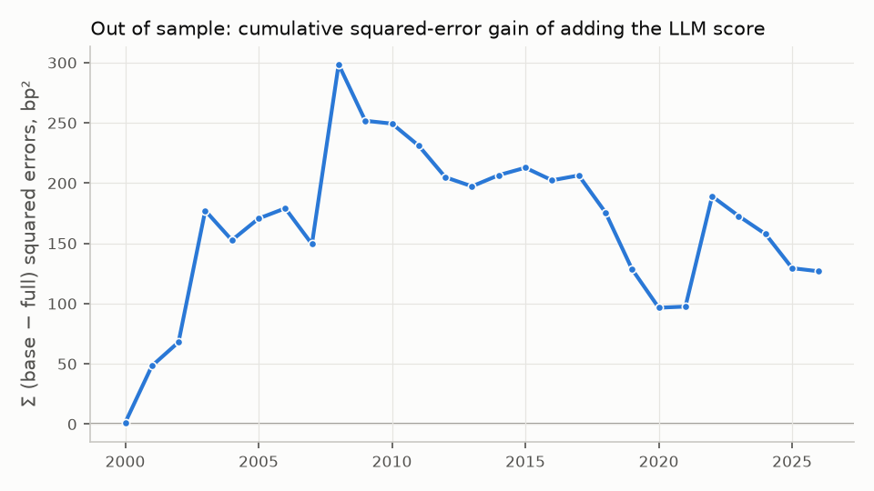

# An LLM Tone Score for FOMC Statements and the 2-Year Yield

*text-signals, case study 1. Research report, November 2026. The full protocol, with every
decision, its date and its reason, is in [`docs/case-studies/fomc.md`](../docs/case-studies/fomc.md)
(cited below as §).*

## Summary

A local 14 B model (Phi-4) reads each FOMC statement into a structured, evidence-backed
extraction. Its aggregate tone score explains the 2-year Treasury yield's move in the 30
minutes around the release, beyond the rate surprise and two classic text baselines.
Statements whose tone is one standard deviation more hawkish see a **+1.03 bp** move (HAC
p = 0.004, n = 243; bootstrap 95% interval 0.36 to 1.77 bp). The specification was fixed before
any score met market data. The effect holds under every pre-specified robustness check and in a
permutation placebo. Out of sample, the score adds **2.1%** to the baseline's R² (Clark–West
p = 0.003).

The result has clear limits, all reported:

- it does not reach the daily close;
- it is much weaker on press conference days, which since 2019 means every meeting;
- its out-of-sample gain was earned before 2009 and in 2022.

**Look-ahead bias** is tested from several angles, because the model has read the history of
almost every statement it scores. The model can date an anonymised statement within about a
year, so it knows the period. When a statement's forward guidance is rewritten, however, the
score follows the rewrite every time, as much for statements the model may remember as for those
it cannot. A frontier model that knows even more history (Claude Opus) finds the same β and a
weaker out-of-sample fit. Look-ahead is not excluded, but there is no sign that it drives the
result.

A **retrieval agent** over 608 FOMC documents answers 21 of 32 test questions right, with 95%
of its citations verbatim. It is a separate deliverable that measures reliability, not part of
the signal. Its failures are instructive: quotes that are exact but attached to
the wrong meeting, and one answer taken from memory despite a point-in-time filter.

## 1. Question and design

When the FOMC releases a statement, the decision is usually priced in; what moves bonds is what
the text implies about the future path of policy (Gürkaynak, Sack and Swanson, 2005). The study
asks whether an LLM reading only the text can measure that stance well enough to explain the
market's reaction, beyond the decision and beyond dictionary and encoder baselines, and how much
survives once look-ahead bias is addressed (§1).

**Event and outcome.** One observation per statement: the change in the 2-year yield in the
30-minute window around the release (San Francisco Fed USMPD, `UST2Y`). The window isolates the
statement from the press conference and from same-day news; the daily change is kept as a
robustness outcome (§3.4, §4.2).

**Point-in-time rule.** Every document is keyed by its *release* timestamp, never the meeting
date. Release dates were checked against four sources; two calendar errors and four USMPD minutes
dates that are off by a day or more were found and corrected (§3.5).

**Model.** OLS, Δy = α + β·tone + γ·MP1 + δ′·baselines + ε, where MP1 is Kuttner's (2001)
futures-based surprise in the rate decision, and the baselines are the Loughran–McDonald net
negative share and FinBERT's mean P(negative) − P(positive). Inference is Newey–West HAC with
4 lags, chosen a priori. **One primary test** (H0: β = 0); 14 secondary tests corrected together
by Holm. Power was computed before scoring: the test detects about **0.92 bp per SD** with 80%
power (§6.3).

**Sample.** 250 statements, February 1994 to October 2026. The primary sample has 243 with every
variable, after dropping a misdated USMPD row and two statements released with a Chair's speech
(§3.4).

## 2. Measuring tone

**Extraction.** The model fills a Pydantic schema (§5.2):

- five stance fields on a common −2 (dovish) to +2 (hawkish) scale: forward guidance,
  inflation, labour market, growth and balance sheet;
- the risk balance and the decision with its size;
- dissents.

Every field carries a span copied verbatim from the statement as evidence. The tone score is the
equal-weight mean of the filled stance fields, so no weight is fitted to the outcome.

**Evaluation without ground truth.** Hand labelling by the maintainer stopped after five practice
statements: it was too slow for a non-specialist. Claude (Opus) became a *reference reader*,
reading 65 statements blind. Agreement with it measures consistency, not truth (§6.6). Checks
that need no reader are used alongside: the decision and its size against FRED, and whether each
evidence span appears verbatim. On a fresh confirmation sample of 30, fixed in advance, Phi-4
gave:
- 0 invalid outputs;
- tone correlation 0.86 with the reference;
- forward guidance κ 0.62 (quadratic weights).

The choices made along the way are reported, failures included:
- Qwen3-Coder inverted the sign of balance-sheet purchases (κ 0.07) and was replaced;
- an evidence-by-sentence-number schema cut hallucinations but collapsed the forward guidance κ
  (0.84 → 0.30);
- a repair loop fixed evidence but changed values, so scores use the first answer only.

| On the 65-statement evaluation sample | Phi-4 | Claude (reference) |
|---|---|---|
| Invalid outputs | 0 | 0 |
| Decision direction right (FRED) | 64 / 65 | 65 / 65 |
| Evidence spans not verbatim | 28 / 403 | 0 / 379 |
| Tone correlation with the reference | 0.91 | – |

## 3. Results

### 3.1 Primary test (H1)

| Regressor | β per SD (bp) | HAC p |
|---|---|---|
| LLM tone (Phi-4) | **+1.03** | **0.004** |
| MP1 (rate surprise) | +2.11 | 0.002 |
| Loughran–McDonald net negative | −0.39 | 0.28 |
| FinBERT net negative | −0.00 | 0.99 |

R² rises from 0.198 to 0.221 when the LLM score is added. The baselines carry nothing once it is
in. FinBERT alone is significant before correction (p = 0.009), but it measures news sentiment
("Inflation remains elevated." scores 0.66 positive).

**Robustness, all fixed in advance:**

| Check | β per SD (bp) | p |
|---|---|---|
| HC3 | 1.03 | 0.014 |
| Moving-block bootstrap | 1.03 | 95% interval [0.36, 1.77] |
| Without the 19 influential statements (Cook's 4/T) | 1.01 | 0.001 |
| Huber robust regression | 0.73 | 0.022 |

The residuals are strongly heteroskedastic and fat-tailed but not autocorrelated; collinearity is
negligible (VIF ≤ 1.63). Huber, which down-weights large moves, gives about a third less. The
estimate to report is 1.03 bp per SD, with 0.73 as the lower robust figure.

### 3.2 Secondary tests, and where the effect stops

Five of 14 survive Holm (§6.3). The ones that bound the result:

- **No effect on the daily close** (−0.07 bp per SD, p = 0.91). The tone moves yields in the
  window; nothing here shows the move lasts. The 30-minute reaction may be reversed or swamped
  later in the day, or the daily change may simply be too noisy.
- **Much weaker on press conference days** (+0.48, n = 96, against +1.70 on other days, Holm
  p = 0.039). When the Chair speaks 30 minutes later, markets seem to wait. Since 2019 this is
  every meeting.
- **H2, the change in tone from the previous statement**, points the same way (+0.85) but does
  not survive Holm (0.079): not established.
- The 10-year moves about as much as the 2-year, so the curve shifts rather than twists.

### 3.3 Out of sample

The model is refitted every January on past statements only and forecasts that year, from 2000
to 2026 (225 statements). Adding the LLM score lowers the squared forecast error by **2.1%**
against the baseline (Clark–West t = 2.73, one-sided p = 0.003).

The gain is not steady. It is earned in 2000–2008 and in 2022, and lost in most other years.
On recent years alone, the score would not have helped a forecaster.

### 3.4 Placebos

- Shuffling the score across statements (9,999 permutations) leaves t-statistics centred on 0
  with unit spread; the observed t of 2.85 is beyond 99.5% of them (p = 0.005).
- The previous statement's score explains nothing on its own.
- One expectation **failed**. Next to the current score, the previous one is significantly
  *negative* (−1.04 bp per SD, p = 0.034), where the placebo expected zero. The market seems to
  respond to the new tone net of the tone already known, like a surprise. This reading was formed
  after seeing the result and is not tested; the primary estimate is unchanged.

## 4. Look-ahead bias (H3)

Phi-4's training data end in June 2024, so it has read the history of 230 of the 250
statements. A model that knows how markets took a statement could let that shade its reading.
The pre-registered tests, and the further tests specified later in the same way (§6.7):

| Test | Question | Result |
|---|---|---|
| Cutoff split | Is the effect weaker after the cutoff? | β = −0.44 (se 1.38) on 19 statements: not detectable; no power, stated in advance |
| Regime-matched split | Does the press conference regime explain that weakness? | Before the cutoff, on press conference days, β = +0.56 (n = 77): inconclusive by the pre-set rule. The regime halves the effect but does not remove it |
| Anonymisation | Does the reading lean on dates and names? | No: scores correlate 0.96 with the originals; β 0.85 vs 0.97 |
| Dating probe | Can the model date an anonymised statement? | Yes: 81% within one year, 0.4 years of error in 2005–2019, but never after 2023 |
| Look-ahead-free reader (ChronoGPT vintages) | Does a model trained only on earlier text find the effect? | That reader cannot read the statements (r = 0.04 with the reference, against a 0.30 bar): no evidence either way |
| **Counterfactual edits** | Does the score follow the text when the text contradicts memory? | **Yes.** On 38 statements, a hawkish rewrite of the guidance sentence beats the dovish one 100% of the time, before and after the cutoff alike. Statements the model may remember move slightly *more* (+0.33, 95% interval −0.07 to +0.68) |

The step that look-ahead requires, knowledge of the period shading the score, is tested directly
by the counterfactual edits, and it is not found. Two statements, one on each side of the cutoff,
share the same guidance sentence and got identical rewrites; Phi-4 reads them identically. The
edits were written and frozen before any edited text was read. Statements whose text kept other
guidance sentences, which pull the reading back like memory would, were flagged in advance; the
result holds without them.

**Conclusion on H3.** The score is a reading of the text by a model that knows the period, and
nothing found indicates that this knowledge drives it. The edits cannot exclude memory shading
borderline readings where text and memory agree, and the weaker effect after the cutoff is
unexplained but too noisy to interpret.

## 5. Does a frontier model read better?

Claude Opus 5.5 scored all 250 statements as an exploratory second reader, specified before
any reading (§6.9). For economy it read them in batches rather than one per call as the local
model did, on anonymised texts shuffled across years to limit recognition.

| | Phi-4 (original texts, primary) | Phi-4 (anonymised) | Claude (anonymised) |
|---|---|---|---|
| Decision right vs FRED | – | 96% | 96% |
| Statements with non-verbatim evidence | – | ~33% | **0%** |
| β per SD (bp), HAC p | 0.97, 0.006 | 0.84, 0.012 | **0.90, 0.007** |
| Out-of-sample R² vs baseline | 2.6% | 1.3% | 0.4% |

(Same 239 statements throughout.) Claude's tone correlates 0.89 with Phi-4's, and in a joint
regression neither adds to the other. **The frontier model extracts more cleanly but finds no
stronger signal.** The tone of a statement is coarse enough that a 14 B local model captures what
moves the 2-year yield.

It also gives an indirect argument on look-ahead. Claude's training data cover all but 3
statements; if knowing what followed drove the scores, the model that knows most should fit
best, and it does not.

## 6. A retrieval agent, and how far its citations can be trusted

The second deliverable is a question-answering agent over the full corpus: 250 statements, 262
sets of minutes and 96 press conference transcripts, cut into 26,354 passages (§6.8).

**What it is for.** The agent does not feed the tone score, the regression or the
out-of-sample test. It answers the project's second question: when an LLM answers a research
question and cites its sources, can the citations be trusted? Sourced question answering over a
document corpus is the first tool a research team typically builds with an LLM, so its failure
modes matter as much as the signal's. Section 9 shows how it could also feed the signal.

**How it works:**
- retrieval fuses BM25 and a small dense encoder (bge-small) by reciprocal rank fusion;
- an `as_of` filter enforces the point-in-time rule;
- Phi-4 answers from the top 8 passages in a JSON schema, with verbatim quotes, or refuses;
- code checks every quote.

**Evaluation:**
- 50 questions, written with reference passages that were found without the retriever, and
  committed before any answer;
- 10 development questions, the only ones used for tuning, and 40 test questions, run once;
- 10 of the 50 are traps the agent should refuse.

The development questions led to one change. Indexing each passage with a header from its
document's metadata ("FOMC statement released July 29, 2026") raised recall@8 from 0.25 to 0.62,
and to 0.59 on the test set. Development also led to one prompt revision, adopted by a rule
fixed before running it.

| Test set (40 questions) | Result |
|---|---|
| Retrieval recall@8 (fusion; BM25 0.50, encoder 0.53) | 0.59 |
| Answerable questions: right / partial / wrong / refused | 21 / 6 / 1 / 4 (of 32) |
| Unanswerable questions refused | 6 of 8 |
| Citations verbatim | 60 of 63 (95%); none invented |
| Right, before / after Phi-4's cutoff | 15 / 22, 6 / 10 |

Three lessons for anyone deploying such a tool:

- **Retrieval is the bottleneck.** When the right passage is retrieved, the answer is almost
  always right and well cited.
- **Citations are reliable word for word, but not in time.** Two answers quote exact text from
  a different meeting: George's June 2022 dissent is given for March 2022, and Hammack's December
  2024 dissent for September 2024. Checking the quote alone would not catch it.
- **A point-in-time filter is not enough.** Asked as of 1 December 2015, before the first rate
  rise, the agent answered "0.25–0.50 percent". The figure is right, but it appears in none of
  the retrieved passages: it came from memory, against the prompt. This is look-ahead in
  miniature.

## 7. Limitations and negative results

- **Small sample, wide intervals.** 243 events; the estimate is close to the minimum detectable
  effect, and its interval runs from 0.36 to 1.77 bp per SD.
- **The effect does not reach the close** and is weak on press conference days, which limits its
  relevance to today's FOMC.
- **No ground truth for the extraction.** Agreement is measured against a stronger model, and the
  scale's hardest field (forward guidance) has κ around 0.6–0.7 out of sample.
- **The intraday data come from USMPD as published**; tick data could not be used to rebuild them.
- **Negative or failed results reported in the protocol**:
  - the daily outcome;
  - H2 not established;
  - a placebo expectation that failed;
  - ChronoGPT too weak to serve as a reader;
  - an inconclusive regime test;
  - two rejected extraction variants and one rejected model;
  - an imperfect trap question in the evaluation set.
- **Choices made after seeing a result are labelled as such**, among them the first-answer rule,
  the citation categories and the retrieval header. Each was made on development data, and test
  data were run once afterwards.

## 8. What this means for investment research

- A local open-weight model gives an auditable, verbatim-sourced reading of central bank text
  with a measurable link to rates, at no marginal cost and with no document leaving the machine.
  For this task a frontier model buys auditability, not signal.
- The link is real but narrow: an intraday, level effect, concentrated before routine press
  conferences. A rates desk would treat it as one input, not a strategy.
- Look-ahead bias deserves its own experiments. Cutoff splits alone had no power here, and
  anonymisation removed too little. Counterfactual edits of the text were the test that
  separated reading from remembering.
- The same pipeline applies to the next corpora (minutes, transcripts, filings, other central
  banks): a source module, a schema and a protocol.

## 9. Next step: tone relative to expectations

The two halves of the study can be joined. The failed placebo (§3.4) suggests the market
responds to the new tone **net of what was already known**, a surprise, and H2's crude version
of this (the change in score from the previous statement) did not survive correction. The
retrieval agent can measure the surprise more directly:

1. For each statement, retrieve with the `as_of` filter set to the day before the release what
   the market could read: the previous statement, the latest minutes and the latest press
   conference.
2. Ask the model what the new statement changes relative to those documents, with verbatim
   evidence on both sides.
3. Score that change, and enter it in the primary specification in place of the tone level,
   in sample and out of sample.

This "tone relative to expectations" is point-in-time by construction, since it only uses
documents released before the statement. It turns the agent's retrieval into an input to the
signal. Because it was suggested by a result already seen, it would have to be specified and
frozen before any score is computed, and reported as exploratory. The agent's own lessons apply
to it: the prompt must tie each claim to its document's date, and the score must be checked
against answers taken from memory.

## Reproducing

Everything a result depends on lives in `src/text_signals/` and is tested (`just lint`,
`just test`). Raw files are stored with URL, fetch time and sha256; every LLM output with model,
weights file, prompt and schema versions. The main steps are listed in the README; each result in
this report names its command in the protocol.

## References

Araci (2019), FinBERT. Clark and West (2007), *Journal of Econometrics*. Gürkaynak, Sack and
Swanson (2005), *International Journal of Central Banking*. He, Lv, Manela and Wu (2025),
ChronoGPT. Kuttner (2001), *Journal of Monetary Economics*. Loughran and McDonald (2011),
*Journal of Finance*. Newey and West (1994), *Review of Economic Studies*. Full list in §11 of
the protocol.
